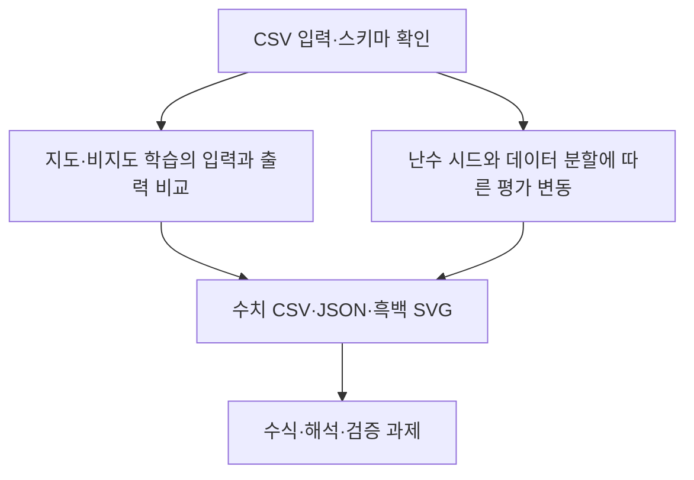

# 제1장 추가 실습

현재 Word 원고의 1.11절과 1.12절에 대응한다. 저장소의 기존 폴더 번호와 현재 Word 장 번호는 일부 다르므로 이 대응을 우선한다.

- [1.11 지도·비지도 학습의 입력과 출력 비교](sec_11_learning_modes.md) — [코드](sec_11_learning_modes.py)
- [1.12 난수 시드와 데이터 분할에 따른 평가 변동](sec_12_seed_sensitivity.md) — [코드](sec_12_seed_sensitivity.py)

[통합 Jupyter 노트북](chapter_practice.ipynb) · [데이터 카드](data_card.json) · [편집 가능한 과정 원본](process.mmd)

