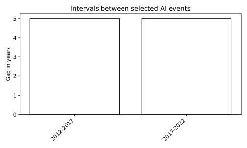

# 1.9.2 문항 8 조건 변경 참고 실습

기존 ai_history.csv의 사건 9개를 그대로 사용합니다. 연속 사건의 간격을 손으로 확인할 수 있어 선택했습니다. 사건 선택 목록의 간격이며 기술 발전 속도나 산업 성장률은 아닙니다.

## 선정 이유

기준 프로그램의 조건 하나를 바꾼 참고 구현입니다. 코드 차이와 실제 결과를 대조하고 테스트 결과로 가장 좋은 조건을 반복 선택하지 않습니다. 원인 해석과 보고서는 독자가 작성합니다.

- [셀별 노트북](q08_parameter_change.ipynb)
- [전체 코드](q08_parameter_change.py)
- [전체 문자 출력](results/q08_parameter_change/stdout.txt)

노트북은 해당 파일이 있는 폴더에서 위에서 아래로 실행합니다. 라이브러리 가져오기와 함수 정의를 생략하지 않습니다. 코드만 복사하면 입력 자료가 빠질 수 있으므로 장별 data 폴더를 함께 내려받거나 저장소 전체 ZIP을 사용합니다.

## 셀별 설명

### 셀 1 라이브러리 가져오기

가져오기(Import) 문장으로 경로 객체(Path)를 연결합니다. 이 셀에서는 자료를 학습하지 않습니다.

가져오기(Import) 문장으로 자바스크립트 객체 표기법(JavaScript Object Notation, JSON) 도구를 연결합니다. 이 셀에서는 자료를 학습하지 않습니다.

가져오기(Import) 문장으로 수치 배열 도구 넘파이(Numerical Python, NumPy)의 별칭 np를 연결합니다. 이 셀에서는 자료를 학습하지 않습니다.

가져오기(Import) 문장으로 자료 표 도구 판다스(pandas)의 별칭 pd를 연결합니다. 이 셀에서는 자료를 학습하지 않습니다.

가져오기(Import) 문장으로 맷플롯립 파이플롯(Matplotlib Pyplot)의 별칭 plt를 연결합니다. 이 셀에서는 자료를 학습하지 않습니다.

가져오기(Import) 문장으로 셀 출력 표시 함수(display), 이미지 표시 객체(IPython Image)를 연결합니다. 이 셀에서는 자료를 학습하지 않습니다.

가져오기(Import) 문장으로 platform 기능를 연결합니다. 이 셀에서는 자료를 학습하지 않습니다.

가져오기(Import) 문장으로 random 기능를 연결합니다. 이 셀에서는 자료를 학습하지 않습니다.

가져오기(Import) 문장으로 파이토치(PyTorch)의 텐서·자동 미분 도구를 연결합니다. 이 셀에서는 자료를 학습하지 않습니다.

### 셀 2 입력·계산·출력 확인

계산 결과의 축·제목·기호·범례를 설정합니다. 표시 방식이 바뀌어도 원본 수치가 바뀌는 것은 아닙니다.

현재 노트북 또는 프로그램 폴더(Current Directory, HERE)를 오른쪽 식으로 계산하여 다음 단계에서 재사용합니다. 값과 형태(Shape)를 구분합니다.

장 폴더(Chapter Directory, CHAPTER)를 오른쪽 식으로 계산하여 다음 단계에서 재사용합니다. 값과 형태(Shape)를 구분합니다.

입력 자료 폴더(Data Directory, DATA)를 오른쪽 식으로 계산하여 다음 단계에서 재사용합니다. 값과 형태(Shape)를 구분합니다.

결과 저장 폴더(Output Directory, OUT)를 오른쪽 식으로 계산하여 다음 단계에서 재사용합니다. 값과 형태(Shape)를 구분합니다.

앞 셀의 값을 사용하여 OUT.mkdir(parents=True, exist_ok=True) 동작을 수행합니다. 셀 순서를 바꾸거나 중간 셀을 생략하지 않습니다.

검증 조건(Assertion)이 참인지 확인합니다. 거짓이면 셀을 중단하며 성공한 결과로 기록하지 않습니다.

### 셀 3 함수와 모듈 정의

현재 계산으로 만든 그림을 SVG와 300dpi PNG로 저장하고 노트북 셀에 표시합니다.

### 셀 4 함수와 모듈 정의

계산한 지표를 JSON 파일과 셀의 문자 출력으로 기록합니다.

### 셀 5 입력·계산·출력 확인

난수 초기값(Random Seed, SEED)를 오른쪽 식으로 계산하여 다음 단계에서 재사용합니다. 값과 형태(Shape)를 구분합니다.

앞 셀의 값을 사용하여 random.seed(SEED) 동작을 수행합니다. 셀 순서를 바꾸거나 중간 셀을 생략하지 않습니다.

앞 셀의 값을 사용하여 np.random.seed(SEED) 동작을 수행합니다. 셀 순서를 바꾸거나 중간 셀을 생략하지 않습니다.

앞 셀의 값을 사용하여 torch.manual_seed(SEED) 동작을 수행합니다. 셀 순서를 바꾸거나 중간 셀을 생략하지 않습니다.

문자 출력(Print)으로 현재 계산 상태를 확인합니다. 화면 반올림 값과 내부 배열의 정밀도는 다를 수 있습니다.

문자 출력(Print)으로 현재 계산 상태를 확인합니다. 화면 반올림 값과 내부 배열의 정밀도는 다를 수 있습니다.

변수 device를 오른쪽 식으로 계산하여 다음 단계에서 재사용합니다. 값과 형태(Shape)를 구분합니다.

문자 출력(Print)으로 현재 계산 상태를 확인합니다. 화면 반올림 값과 내부 배열의 정밀도는 다를 수 있습니다.

자료 표(Data Frame, df)에 CSV 파일을 표로 읽습니다. 열 이름과 목표 열을 다음 출력에서 확인합니다.

자료 표(Data Frame, df)를 오른쪽 식으로 계산하여 다음 단계에서 재사용합니다. 값과 형태(Shape)를 구분합니다.

문자 출력(Print)으로 현재 계산 상태를 확인합니다. 화면 반올림 값과 내부 배열의 정밀도는 다를 수 있습니다.

문자 출력(Print)으로 현재 계산 상태를 확인합니다. 화면 반올림 값과 내부 배열의 정밀도는 다를 수 있습니다.

변수 years를 오른쪽 식으로 계산하여 다음 단계에서 재사용합니다. 값과 형태(Shape)를 구분합니다.

변수 gaps를 오른쪽 식으로 계산하여 다음 단계에서 재사용합니다. 값과 형태(Shape)를 구분합니다.

문자 출력(Print)으로 현재 계산 상태를 확인합니다. 화면 반올림 값과 내부 배열의 정밀도는 다를 수 있습니다.

문자 출력(Print)으로 현재 계산 상태를 확인합니다. 화면 반올림 값과 내부 배열의 정밀도는 다를 수 있습니다.

문자 출력(Print)으로 현재 계산 상태를 확인합니다. 화면 반올림 값과 내부 배열의 정밀도는 다를 수 있습니다.

### 셀 6 입력·계산·출력 확인

문자 출력(Print)으로 현재 계산 상태를 확인합니다. 화면 반올림 값과 내부 배열의 정밀도는 다를 수 있습니다.

문자 출력(Print)으로 현재 계산 상태를 확인합니다. 화면 반올림 값과 내부 배열의 정밀도는 다를 수 있습니다.

문자 출력(Print)으로 현재 계산 상태를 확인합니다. 화면 반올림 값과 내부 배열의 정밀도는 다를 수 있습니다.

계산 결과의 축·제목·기호·범례를 설정합니다. 표시 방식이 바뀌어도 원본 수치가 바뀌는 것은 아닙니다.

계산 결과의 축·제목·기호·범례를 설정합니다. 표시 방식이 바뀌어도 원본 수치가 바뀌는 것은 아닙니다.

계산 결과의 축·제목·기호·범례를 설정합니다. 표시 방식이 바뀌어도 원본 수치가 바뀌는 것은 아닙니다.

계산 결과의 축·제목·기호·범례를 설정합니다. 표시 방식이 바뀌어도 원본 수치가 바뀌는 것은 아닙니다.

실제 계산한 그림을 저장하고 출력합니다. 가로축·세로축·범례의 의미는 이 실습의 결과 해설에서 확인합니다.

계산된 값만 결과 파일과 셀 출력에 기록합니다. 이후 비교에는 출력 파일과 데이터 버전을 함께 사용합니다.

## 실제 결과

IPython 셀 순차 실행으로 계산했습니다. 별도 Jupyter 메시징 커널·브라우저는 소켓 제한 때문에 확인하지 못했습니다.

```json
{
  "summary": {
    "events": 3,
    "mean_gap": 5.0,
    "seed": 42,
    "device": "cpu"
  }
}
```



## 그림과 값의 해석

기준 프로그램의 조건 하나를 바꾼 참고 구현입니다. 코드 차이와 실제 결과를 대조하고 테스트 결과로 가장 좋은 조건을 반복 선택하지 않습니다. 원인 해석과 보고서는 독자가 작성합니다. 막대 높이는 인접 사건의 연도 차이입니다. 사건 선정이 달라지면 간격도 달라집니다.
