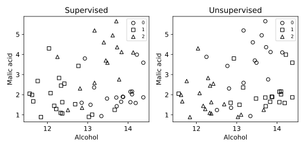

# 1.11 지도·비지도 학습의 입력과 출력 비교

같은 입력 X에서 정답 y를 쓰는 분류와 쓰지 않는 군집화의 차이를 확인한다.

## 실행

```bash
python sec_11_learning_modes.py
```

Python 3.12.14에서 정상 종료 확인. 장 폴더를 작업 위치로 삼아 실행하며, 프로그램은 스크립트 위치에서 입력 경로를 찾는다.

## 입력 자료

- `data/wine.csv`: 178행, 14열. scikit-learn 내장 Wine 데이터(load_wine), UCI Wine에서 유래한 178개 관측. 생성 자료 아님. 13개 연속형 화학 분석 특성과 target(0,1,2). 7장은 target==0을 양성으로 재정의한다. 물리 단위는 원 출처 설명을 확인한다.
- 열: alcohol, malic_acid, ash, alcalinity_of_ash, magnesium, total_phenols, flavanoids, nonflavanoid_phenols, proanthocyanins, color_intensity, hue, od280_od315_of_diluted_wines, proline, target
- SHA-256: `47946bdb6b5017961c6e2b5daa8a74b0d98779c1c66f21645d1d737eded7e8cb`

## 소스와 해설

[프로그램 원본](sec_11_learning_modes.py)

시작 1~5행은 pathlib·sys와 공통 모듈의 경로 및 CSV/출력 폴더를 정한다. 입력은 스크립트 위치 기준이므로 사용자의 현재 작업 폴더와 분리된다.

- 15행 `train, test =`: train과 test에는 데이터 값이 아니라 행 번호가 들어간다. stratify=y는 품종 비율을 가능한 한 유지한다. iloc는 이 번호를 위치로 해석해 입력과 정답을 같은 행에서 꺼낸다.

- 17행 `clf =`: make_pipeline은 표준화와 분류기를 하나로 연결한다. fit을 훈련 입력에만 호출하므로 테스트 평균·표준편차가 훈련 전처리에 섞이지 않는다. LogisticRegression은 이름에 회귀가 있지만 이 예에서는 세 품종을 분류한다.

- 20행 `cluster =`: KMeans는 훈련 입력의 거리 구조로 중심 3개를 찾는다. random_state는 초기 중심의 재현 조건이며 n_init=10은 서로 다른 초기화 중 관성을 비교한다. 실제 품종 y는 이 학습 호출에 전달되지 않는다.

- 24행 `metrics =`: Accuracy는 테스트 정답과 분류 예측의 일치 비율이다. Adjusted Rand Index(조정 랜드 지수, ARI)는 두 관측 쌍의 군집 관계를 비교하므로 군집 번호를 바꾸어도 값이 같다. ARI 0은 무작위 기준과 비슷한 일치이고 1은 완전한 일치다.

- 27행 `for ax, labels`: zip은 두 축과 두 종류의 출력, 제목을 같은 순서로 묶는다. mask는 현재 번호의 점만 고르는 불리언 배열이다. 그림에는 첫 두 입력 특성만 쓰므로 그림에서 겹친다고 13차원 입력에서도 구분 불가능한 것은 아니다.

## 실제 실행 결과

```json
{
  "test_n": 54,
  "accuracy": 0.9814814814814815,
  "cluster_ARI": 0.8341623876765083
}
```



왼쪽 기호는 예측 품종, 오른쪽 기호는 군집 번호다. 군집 번호와 품종 번호는 같은 뜻이 아니므로 단순 일치율 대신 ARI를 쓴다.

강화학습과 생성형 학습을 실행한 예제가 아니다. 첫 두 특성만 그렸으며 모델은 13개 특성을 사용한다.

## 확인 과제와 채점 기준

학습 때 cluster.fit에 정답을 넣지 않았는지 확인하고, test_n·Accuracy·ARI를 서로 다른 의미로 해석한다.

입력·분할·출처 확인 2점, 재실행과 산출물 일치 3점, 수치·그림 해석 3점, 한계와 실패 사례 설명 2점. 제출물은 변경 코드, 결과 CSV/JSON, 비교 그림, 5문장 해석이다.
