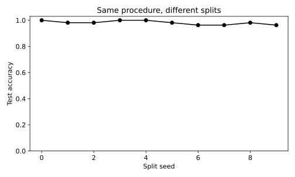

# 1.12 난수 시드와 데이터 분할에 따른 평가 변동

실행 환경을 기록하고 같은 절차의 평가 수치가 분할에 따라 얼마나 바뀌는지 관찰한다.

## 실행

```bash
python sec_12_seed_sensitivity.py
```

Python 3.12.14에서 정상 종료 확인. 장 폴더를 작업 위치로 삼아 실행하며, 프로그램은 스크립트 위치에서 입력 경로를 찾는다.

## 입력 자료

- `data/wine.csv`: 178행, 14열. scikit-learn 내장 Wine 데이터(load_wine), UCI Wine에서 유래한 178개 관측. 생성 자료 아님. 13개 연속형 화학 분석 특성과 target(0,1,2). 7장은 target==0을 양성으로 재정의한다. 물리 단위는 원 출처 설명을 확인한다.
- 열: alcohol, malic_acid, ash, alcalinity_of_ash, magnesium, total_phenols, flavanoids, nonflavanoid_phenols, proanthocyanins, color_intensity, hue, od280_od315_of_diluted_wines, proline, target
- SHA-256: `47946bdb6b5017961c6e2b5daa8a74b0d98779c1c66f21645d1d737eded7e8cb`

## 소스와 해설

[프로그램 원본](sec_12_seed_sensitivity.py)

시작 1~5행은 pathlib·sys와 공통 모듈의 경로 및 CSV/출력 폴더를 정한다. 입력은 스크립트 위치 기준이므로 사용자의 현재 작업 폴더와 분리된다.

- 15행 `for seed in`: 각 반복은 데이터 분할과 새 모델 학습을 다시 수행한다. 데이터 자체와 알고리즘 설정은 유지하며 분할 난수만 바꾼다. 시드 0이 시드 9보다 앞선 학습 단계라는 의미는 없다.

- 16행 `a,b =`: 클래스 비율을 유지한 70:30 분할을 한다. 같은 시드·같은 라이브러리·같은 입력 파일에서는 동일한 행 번호를 얻도록 설계되었다. 다른 버전에서의 결과까지 비트 단위로 보장하지는 않는다.

- 19행 `model.fit`: 표준화 평균과 표준편차는 매 반복의 훈련 표본에서 새로 계산된다. 전처리까지 훈련 부분에 묶어야 모델 간 비교 절차가 일관된다.

- 22행 `result =`: rows는 반복별 사전의 리스트이고 DataFrame은 이를 행과 열로 정리한다. CSV 한 행은 한 분할 실험이며 여러 모델의 epoch 기록이 아니다.

- 28행 `report(`: 표본 표준편차는 ddof=1로 계산하여 평균에서 벗어난 제곱합을 9로 나눈다. 테스트 표본 중복 때문에 이 값으로 독립 반복의 표준오차나 모집단 신뢰구간을 바로 계산하지 않는다.

## 실제 실행 결과

```json
{
  "python": "3.12.14",
  "sklearn": "1.8.0",
  "accuracy_mean": 0.9814814814814815,
  "accuracy_std_ddof1": 0.015120307054217172
}
```



가로축은 난수 시드 번호이고 시간 순서가 아니다. 점 사이의 선은 시각적 연결일 뿐 연속적인 학습 곡선이 아니다.

10회 분할의 테스트 표본은 서로 겹칠 수 있다. 독립 실험 10개나 최종 평가용 고정 홀드아웃을 대체하지 않는다.

## 확인 과제와 채점 기준

10개 결과의 평균과 표본 표준편차를 계산하고, 최고 점수 시드만 보고하는 문제가 무엇인지 설명한다.

입력·분할·출처 확인 2점, 재실행과 산출물 일치 3점, 수치·그림 해석 3점, 한계와 실패 사례 설명 2점. 제출물은 변경 코드, 결과 CSV/JSON, 비교 그림, 5문장 해석이다.
