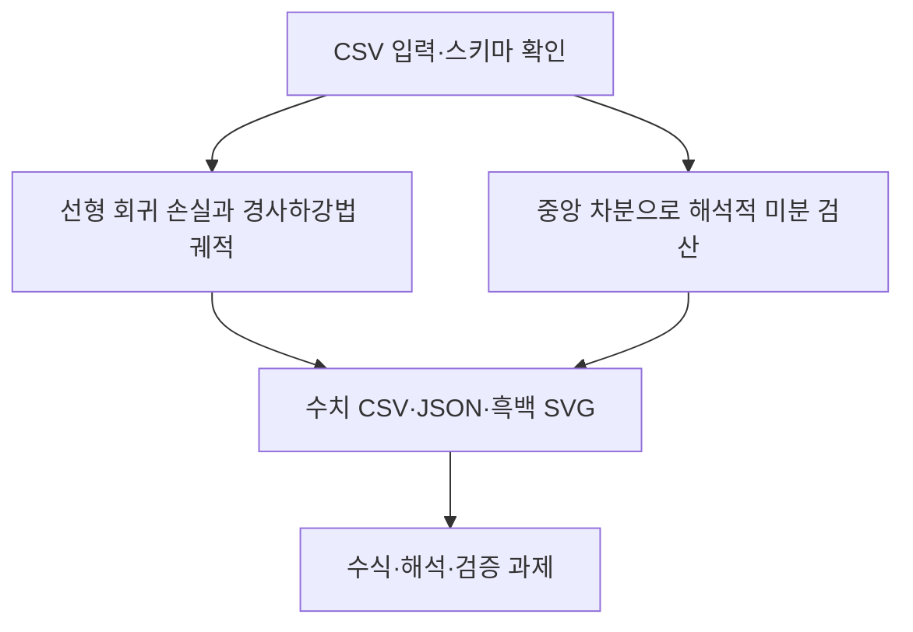

# 제2장 추가 실습

현재 Word 원고의 2.11절과 2.12절에 대응한다. 저장소의 기존 폴더 번호와 현재 Word 장 번호는 일부 다르므로 이 대응을 우선한다.

- [2.11 선형 회귀 손실과 경사하강법 궤적](sec_11_gradient_descent.md) — [코드](sec_11_gradient_descent.py)
- [2.12 중앙 차분으로 해석적 미분 검산](sec_12_gradient_check.md) — [코드](sec_12_gradient_check.py)

[통합 Jupyter 노트북](chapter_practice.ipynb) · [데이터 카드](data_card.json) · [편집 가능한 과정 원본](process.mmd)

