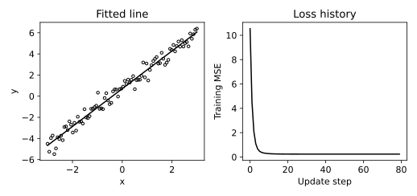

# 2.11 선형 회귀 손실과 경사하강법 궤적

손실 함수의 미분이 파라미터를 바꾸는 방향과 결과 직선의 관계를 확인한다.

## 실행

```bash
python sec_11_gradient_descent.py
```

Python 3.12.14에서 정상 종료 확인. 장 폴더를 작업 위치로 삼아 실행하며, 프로그램은 스크립트 위치에서 입력 경로를 찾는다.

## 입력 자료

- `data/linear.csv`: 90행, 2열. 난수 시드 42로 만든 교육용 합성 데이터. 실제 측정값 아님. x 입력과 y 정답. y=1.8x+0.7+정규 잡음. 단위 없음.
- 열: x, y
- SHA-256: `7f4ec9eabcbef4c2b259d1f11af633bebb2a09a57daf59073b81a88f93a37fec`

## 소스와 해설

[프로그램 원본](sec_11_gradient_descent.py)

시작 1~5행은 pathlib·sys와 공통 모듈의 경로 및 CSV/출력 폴더를 정한다. 입력은 스크립트 위치 기준이므로 사용자의 현재 작업 폴더와 분리된다.

- 8행 `w,b =`: w는 기울기, b는 절편이며 둘 다 0에서 시작한다. x와 y는 길이 90의 1차원 배열이어서 w*x+b가 각 표본에 대한 예측 벡터를 만든다.

- 11행 `error =`: error의 정의는 예측−실제다. 부호가 양수이면 과대 예측이다. 평균제곱오차는 mean(error**2)이며 Python의 **는 제곱 연산자다.

- 14행 `dw,db =`: 기울기의 편미분 dw에는 입력 x가 곱해지고 절편의 편미분 db에는 곱해지지 않는다. 평균을 취하므로 표본 수를 다시 나누지 않는다. 두 값 모두 현재 w와 b의 동일한 오차 벡터에서 계산한다.

- 15행 `w -=`: -=는 현재 값에서 오른쪽 값을 빼 다시 저장한다. 학습률 0.06과 경사를 곱해 손실이 작아지는 쪽으로 이동한다. w를 바꾼 뒤 db를 재계산하지 않아 두 파라미터가 같은 단계의 경사를 쓴다.

- 17행 `history =`: history에 저장한 MSE는 해당 갱신 직전 값이다. JSON의 final_mse는 80번 갱신을 마친 뒤 재계산하므로 마지막 CSV 행과 한 갱신만큼 다를 수 있다.

## 실제 실행 결과

```json
{
  "w": 1.7881074789633025,
  "b": 0.7062523833269793,
  "initial_mse": 10.543754677694318,
  "final_mse": 0.2373908470728377
}
```



왼쪽은 데이터 공간의 적합선, 오른쪽은 갱신 단계별 훈련 MSE다. 손실이 줄어드는 것과 미관측 자료에서 잘 예측하는 것은 별개다.

전체 입력으로 손실 최소화 원리를 보여 준다. 일반화 평가용 실험이 아니며 테스트 정확도를 보고하지 않는다.

## 확인 과제와 채점 기준

학습률을 0.006과 0.6으로 바꿔 안정성과 속도를 비교하되 발산이 나오면 실패도 기록한다.

입력·분할·출처 확인 2점, 재실행과 산출물 일치 3점, 수치·그림 해석 3점, 한계와 실패 사례 설명 2점. 제출물은 변경 코드, 결과 CSV/JSON, 비교 그림, 5문장 해석이다.
