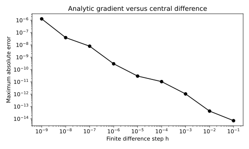

# 2.12 중앙 차분으로 해석적 미분 검산

수식으로 구한 편미분과 수치 미분의 일치를 계산으로 점검한다.

## 실행

```bash
python sec_12_gradient_check.py
```

Python 3.12.14에서 정상 종료 확인. 장 폴더를 작업 위치로 삼아 실행하며, 프로그램은 스크립트 위치에서 입력 경로를 찾는다.

## 입력 자료

- `data/linear.csv`: 90행, 2열. 난수 시드 42로 만든 교육용 합성 데이터. 실제 측정값 아님. x 입력과 y 정답. y=1.8x+0.7+정규 잡음. 단위 없음.
- 열: x, y
- SHA-256: `7f4ec9eabcbef4c2b259d1f11af633bebb2a09a57daf59073b81a88f93a37fec`

## 소스와 해설

[프로그램 원본](sec_12_gradient_check.py)

시작 1~5행은 pathlib·sys와 공통 모듈의 경로 및 CSV/출력 폴더를 정한다. 입력은 스크립트 위치 기준이므로 사용자의 현재 작업 폴더와 분리된다.

- 8행 `theta =`: theta[0]은 w, theta[1]은 b다. 이 배열을 함수 loss에 전달해 동일한 수학식을 해석적 미분과 수치 미분 양쪽에서 공유한다.

- 12행 `analytic =`: 수식으로 미분한 두 성분을 [dw,db] 순서로 저장한다. 비교할 수치 벡터도 같은 파라미터 순서를 사용해야 한다.

- 14행 `for h in`: logspace(-1,-9,9)는 10의 -1제곱부터 -9제곱까지 9개 간격을 만든다. 이 간격은 학습률이 아니라 함수 값을 측정하는 미세한 파라미터 변화다.

- 17행 `delta=np.zeros`: 한 번에 파라미터 하나만 h만큼 바꾸기 위해 다른 성분을 0으로 둔다. 중앙 차분은 [L(θ+δ)−L(θ−δ)]/(2h)이므로 두 번의 함수 평가가 필요하다.

- 28행 `assert r.`: assert는 최소 오차가 10의 -6제곱보다 작은지 검사한다. 실패하면 실행이 성공한 것처럼 다음 결과로 넘어가지 않는다. 그래프의 1e-16 하한은 로그 축 표시용이며 CSV 실제 오차를 바꾸지 않는다.

## 실제 실행 결과

```json
{
  "analytic_dw": -8.515805433112032,
  "analytic_db": -1.8125558900166667,
  "min_abs_error": 7.105427357601002e-15
}
```



가로축과 세로축은 로그 척도다. 간격 h가 작아지면 무조건 정확해지는 것이 아니며 부동소수점 상쇄 오차가 커질 수 있다.

이 실험의 손실은 이차함수여서 중앙 차분의 절단 오차가 매우 작다. 모든 함수에서 같은 오차 곡선이 생기지는 않는다.

## 확인 과제와 채점 기준

dw의 x 인자를 빼고 검산이 실패하는지 확인한 뒤 원래 코드로 복원한다.

입력·분할·출처 확인 2점, 재실행과 산출물 일치 3점, 수치·그림 해석 3점, 한계와 실패 사례 설명 2점. 제출물은 변경 코드, 결과 CSV/JSON, 비교 그림, 5문장 해석이다.
