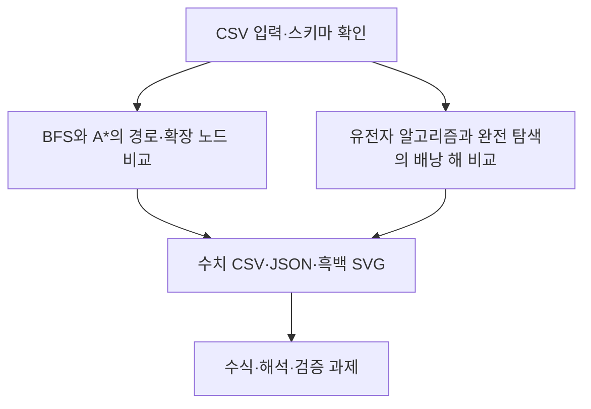

# 제3장 추가 실습

현재 Word 원고의 3.11절과 3.12절에 대응한다. 저장소의 기존 폴더 번호와 현재 Word 장 번호는 일부 다르므로 이 대응을 우선한다.

- [3.11 BFS와 A*의 경로·확장 노드 비교](sec_11_search_compare.md) — [코드](sec_11_search_compare.py)
- [3.12 유전자 알고리즘과 완전 탐색의 배낭 해 비교](sec_12_genetic_knapsack.md) — [코드](sec_12_genetic_knapsack.py)

[통합 Jupyter 노트북](chapter_practice.ipynb) · [데이터 카드](data_card.json) · [편집 가능한 과정 원본](process.mmd)

