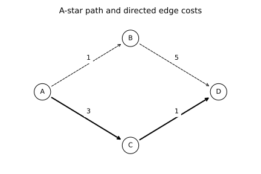

# 3.7 가중 그래프의 최단 경로

A·B·C·D 노드와 간선 비용을 코드에 직접 정의합니다. 두 경로의 비용 6과 4를 손으로 검산하기 쉬워 선택했습니다.

## 선정 이유

A·B·C·D 노드와 간선 비용을 코드에 직접 정의합니다. 두 경로의 비용 6과 4를 손으로 검산하기 쉬워 선택했습니다.

- [셀별 노트북](sec_07_main.ipynb)
- [전체 코드](sec_07_main.py)
- [전체 문자 출력](results/sec_07_main/stdout.txt)

노트북은 해당 파일이 있는 폴더에서 위에서 아래로 실행합니다. 라이브러리 가져오기와 함수 정의를 생략하지 않습니다. 코드만 복사하면 입력 자료가 빠질 수 있으므로 장별 data 폴더를 함께 내려받거나 저장소 전체 ZIP을 사용합니다.

## 셀별 설명

### 셀 1 라이브러리 가져오기

가져오기(Import) 문장으로 경로 객체(Path)를 연결합니다. 이 셀에서는 자료를 학습하지 않습니다.

가져오기(Import) 문장으로 자바스크립트 객체 표기법(JavaScript Object Notation, JSON) 도구를 연결합니다. 이 셀에서는 자료를 학습하지 않습니다.

가져오기(Import) 문장으로 수치 배열 도구 넘파이(Numerical Python, NumPy)의 별칭 np를 연결합니다. 이 셀에서는 자료를 학습하지 않습니다.

가져오기(Import) 문장으로 자료 표 도구 판다스(pandas)의 별칭 pd를 연결합니다. 이 셀에서는 자료를 학습하지 않습니다.

가져오기(Import) 문장으로 맷플롯립 파이플롯(Matplotlib Pyplot)의 별칭 plt를 연결합니다. 이 셀에서는 자료를 학습하지 않습니다.

가져오기(Import) 문장으로 셀 출력 표시 함수(display), 이미지 표시 객체(IPython Image)를 연결합니다. 이 셀에서는 자료를 학습하지 않습니다.

가져오기(Import) 문장으로 heapq 기능를 연결합니다. 이 셀에서는 자료를 학습하지 않습니다.

### 셀 2 입력·계산·출력 확인

계산 결과의 축·제목·기호·범례를 설정합니다. 표시 방식이 바뀌어도 원본 수치가 바뀌는 것은 아닙니다.

현재 노트북 또는 프로그램 폴더(Current Directory, HERE)를 오른쪽 식으로 계산하여 다음 단계에서 재사용합니다. 값과 형태(Shape)를 구분합니다.

장 폴더(Chapter Directory, CHAPTER)를 오른쪽 식으로 계산하여 다음 단계에서 재사용합니다. 값과 형태(Shape)를 구분합니다.

입력 자료 폴더(Data Directory, DATA)를 오른쪽 식으로 계산하여 다음 단계에서 재사용합니다. 값과 형태(Shape)를 구분합니다.

결과 저장 폴더(Output Directory, OUT)를 오른쪽 식으로 계산하여 다음 단계에서 재사용합니다. 값과 형태(Shape)를 구분합니다.

앞 셀의 값을 사용하여 OUT.mkdir(parents=True, exist_ok=True) 동작을 수행합니다. 셀 순서를 바꾸거나 중간 셀을 생략하지 않습니다.

검증 조건(Assertion)이 참인지 확인합니다. 거짓이면 셀을 중단하며 성공한 결과로 기록하지 않습니다.

### 셀 3 함수와 모듈 정의

현재 계산으로 만든 그림을 SVG와 300dpi PNG로 저장하고 노트북 셀에 표시합니다.

### 셀 4 함수와 모듈 정의

계산한 지표를 JSON 파일과 셀의 문자 출력으로 기록합니다.

### 셀 5 함수와 모듈 정의

가장 작은 예상 비용의 상태를 먼저 꺼내 최단 경로를 탐색합니다. 목적지 도달과 더 나쁜 중복 상태의 제외 조건을 구분합니다.

### 셀 6 입력·계산·출력 확인

가중 방향 그래프(Weighted Directed Graph, graph)를 오른쪽 식으로 계산하여 다음 단계에서 재사용합니다. 값과 형태(Shape)를 구분합니다.

휴리스틱 추정 비용(Heuristic Cost Estimates, heuristics)를 오른쪽 식으로 계산하여 다음 단계에서 재사용합니다. 값과 형태(Shape)를 구분합니다.

경로(Path, path)·비용(Cost, cost)를 오른쪽 식으로 계산하여 다음 단계에서 재사용합니다. 값과 형태(Shape)를 구분합니다.

문자 출력(Print)으로 현재 계산 상태를 확인합니다. 화면 반올림 값과 내부 배열의 정밀도는 다를 수 있습니다.

변수 pos를 오른쪽 식으로 계산하여 다음 단계에서 재사용합니다. 값과 형태(Shape)를 구분합니다.

변수 fig·변수 ax를 오른쪽 식으로 계산하여 다음 단계에서 재사용합니다. 값과 형태(Shape)를 구분합니다.

반복 조건 for node,(x,y) in pos.items():에 따라 같은 처리를 수행합니다. 루프 내부의 들여쓰기는 반복마다 실행되며 반복 종료 뒤 변수에는 마지막 계산 상태가 남습니다.

반복 조건 for a,edges in graph.items():에 따라 같은 처리를 수행합니다. 루프 내부의 들여쓰기는 반복마다 실행되며 반복 종료 뒤 변수에는 마지막 계산 상태가 남습니다.

계산 결과의 축·제목·기호·범례를 설정합니다. 표시 방식이 바뀌어도 원본 수치가 바뀌는 것은 아닙니다.

계산 결과의 축·제목·기호·범례를 설정합니다. 표시 방식이 바뀌어도 원본 수치가 바뀌는 것은 아닙니다.

실제 계산한 그림을 저장하고 출력합니다. 가로축·세로축·범례의 의미는 이 실습의 결과 해설에서 확인합니다.

계산된 값만 결과 파일과 셀 출력에 기록합니다. 이후 비교에는 출력 파일과 데이터 버전을 함께 사용합니다.

## 실제 결과

IPython 셀 순차 실행으로 계산했습니다. 별도 Jupyter 메시징 커널·브라우저는 소켓 제한 때문에 확인하지 못했습니다.

```json
{
  "summary": {
    "path": [
      "A",
      "C",
      "D"
    ],
    "cost": 4
  }
}
```



## 그림과 값의 해석

굵은 경로의 간선 비용을 합해 출력 비용과 비교합니다. 그림의 직선 길이는 코드 비용이 아닙니다.
