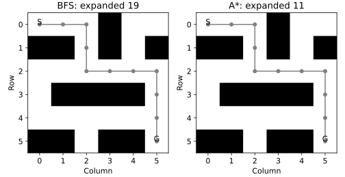

# 3.11 BFS와 A*의 경로·확장 노드 비교

동일한 단위 비용 격자에서 FIFO 탐색과 휴리스틱 탐색을 비교한다.

## 실행

```bash
python sec_11_search_compare.py
```

Python 3.12.14에서 정상 종료 확인. 장 폴더를 작업 위치로 삼아 실행하며, 프로그램은 스크립트 위치에서 입력 경로를 찾는다.

## 입력 자료

- `data/maze.csv`: 6행, 6열. 저자가 정의한 6×6 교육용 격자. 실제 지도 아님. 0 이동 가능, 1 장애물. 시작 (0,0), 목표 (5,5), 상하좌우 비용 1.
- 열: c0, c1, c2, c3, c4, c5
- SHA-256: `1ca72bfcfff0d54858ecebfc6002ff0574c8502b123ee1c3a3b64dd10c029dab`

## 소스와 해설

[프로그램 원본](sec_11_search_compare.py)

시작 1~5행은 pathlib·sys와 공통 모듈의 경로 및 CSV/출력 폴더를 정한다. 입력은 스크립트 위치 기준이므로 사용자의 현재 작업 폴더와 분리된다.

- 10행 `def neighbors`: 좌표는 (행,열) 순서이며 배열 접근도 maze[row,column]이다. 0은 통행 가능, 1은 장애물이다. 상하좌우 4방향만 허용하므로 대각 이동을 경로에 넣으면 이 문제 정의와 달라진다.

- 17행 `frontier=`: A* 우선순위 큐에는 (예상 총 비용,좌표)를 넣는다. cost는 시작점부터의 누적 실제 비용 g, parent는 반환 경로를 복원할 직전 노드다. 같은 우선순위이면 좌표 순서가 동점 해소에 영향을 준다.

- 27행 `h=abs`: 휴리스틱 h는 목표까지의 맨해튼 거리다. 단위 비용 4방향 격자에서 실제 최단 거리보다 커지지 않는다. 장애물의 추가 우회 비용은 포함하지 않아 허용적인 하한이 된다.

- 33행 `def bfs`: deque의 popleft는 먼저 넣은 상태를 먼저 처리한다. parent 등록을 방문 발견 표시로 사용해 같은 노드를 여러 번 큐에 넣지 않는다. A*의 heapq 방식과 FIFO 방식을 코드에서 구분했다.

- 30행 `while u is not None`: 목표에서 parent를 따라 시작점까지 거꾸로 추적하고 [::-1]로 순서를 뒤집는다. path의 노드 수에서 1을 뺀 값이 이동 간선 수다. 두 경로의 길이 일치는 이 입력에 대한 검사이며 모든 구현의 정확성 증명을 대신하지 않는다.

## 실제 실행 결과

```json
{
  "BFS": {
    "steps": 10,
    "expanded": 19
  },
  "A*": {
    "steps": 10,
    "expanded": 11
  }
}
```



검정 칸은 장애물, 회색 선은 반환 경로다. 확장 수는 큐에 넣은 횟수가 아니라 실제 꺼내 처리한 서로 다른 노드 수다.

장애물 없는 맨해튼 거리는 이 조건에서 하한이다. 동점 처리에 따라 두 알고리즘의 경로·확장 수가 달라질 수 있다.

## 확인 과제와 채점 기준

경로가 장애물을 지나지 않는지, 인접 좌표의 맨해튼 거리가 1인지 확인한다.

입력·분할·출처 확인 2점, 재실행과 산출물 일치 3점, 수치·그림 해석 3점, 한계와 실패 사례 설명 2점. 제출물은 변경 코드, 결과 CSV/JSON, 비교 그림, 5문장 해석이다.
