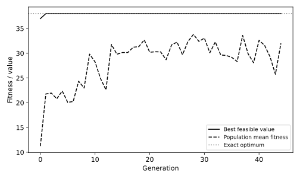

# 3.12 유전자 알고리즘과 완전 탐색의 배낭 해 비교

선택·교차·돌연변이·엘리트 보존을 구현하고 작은 문제의 정확한 최적값과 비교한다.

## 실행

```bash
python sec_12_genetic_knapsack.py
```

Python 3.12.14에서 정상 종료 확인. 장 폴더를 작업 위치로 삼아 실행하며, 프로그램은 스크립트 위치에서 입력 경로를 찾는다.

## 입력 자료

- `data/items.csv`: 8행, 3열. 교육용 8개 배낭 물품을 명시적으로 정의. 실제 상품 가격 아님. weight 중량과 value 효용은 무차원. 허용 중량 15. 선택 비트 0/1.
- 열: item, weight, value
- SHA-256: `5e169c1d25ee11316b139aa3f3f9b43007d8761d69961f8357f2b5cfad2bfabe`

## 소스와 해설

[프로그램 원본](sec_12_genetic_knapsack.py)

시작 1~5행은 pathlib·sys와 공통 모듈의 경로 및 CSV/출력 폴더를 정한다. 입력은 스크립트 위치 기준이므로 사용자의 현재 작업 폴더와 분리된다.

- 11행 `def score`: 개체 한 행은 8비트 선택 벡터다. pop@w는 각 개체의 총중량, pop@v는 총효용이다. np.where는 용량을 넘은 개체를 0점으로 처리한다. 모든 효용이 양수인 이 문제에 맞춘 벌점이다.

- 13행 `all_bits=`: product([0,1],repeat=8)은 가능한 256개 조합을 모두 만든다. 이 결과는 유전자 알고리즘의 부모 선택에 쓰지 않고 최적값을 비교하는 검증 기준으로만 사용한다.

- 17행 `elite=`: 현 세대의 최고 적합도 개체를 copy로 복사해 다음 세대에 보존한다. 참조만 넘긴 뒤 돌연변이로 수정하면 최고 해가 사라질 수 있어 별도 복사한다.

- 24행 `candidates=`: 무작위 후보 3명 중 적합도가 가장 높은 개체를 부모로 고르는 토너먼트 선택이다. 같은 개체가 중복 후보가 될 수 있으므로 완전히 다른 부모 두 명이 보장되지는 않는다.

- 27행 `child=np.r_`: 절단점 앞은 첫 부모, 뒤는 둘째 부모에서 이어 붙인다. logical_xor는 확률 0.05로 선택된 비트를 뒤집는다. 형식을 정수로 바꿔 다음 세대의 행렬 연산과 일치시킨다.

## 실제 실행 결과

```json
{
  "exact_optimum": 38,
  "ga_value": 38,
  "ga_weight": 15,
  "bits": [
    1,
    1,
    0,
    1,
    0,
    0,
    1,
    1
  ]
}
```



실선은 세대 내 최고 적합도, 점선은 전체 개체군 평균이다. 과중량 개체의 적합도 0도 평균에 포함된다.

유전자 알고리즘은 모든 문제에서 최적해를 보장하지 않는다. 이 8개 물품은 완전 탐색이 가능한 작은 검증용 문제다.

## 확인 과제와 채점 기준

용량과 돌연변이 확률을 하나씩 바꿔 최적값과의 차이를 기록한다. 최고값이 유지되는 이유를 엘리트 복사와 연결한다.

입력·분할·출처 확인 2점, 재실행과 산출물 일치 3점, 수치·그림 해석 3점, 한계와 실패 사례 설명 2점. 제출물은 변경 코드, 결과 CSV/JSON, 비교 그림, 5문장 해석이다.
