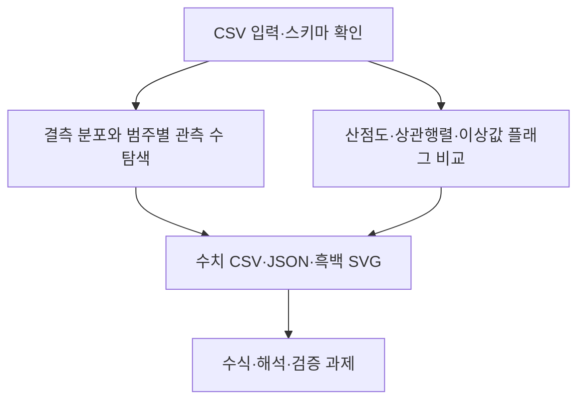

# 제4장 추가 실습

현재 Word 원고의 4.11절과 4.12절에 대응한다. 저장소의 기존 폴더 번호와 현재 Word 장 번호는 일부 다르므로 이 대응을 우선한다.

- [4.11 결측 분포와 범주별 관측 수 탐색](sec_11_missingness.md) — [코드](sec_11_missingness.py)
- [4.12 산점도·상관행렬·이상값 플래그 비교](sec_12_correlation_outlier.md) — [코드](sec_12_correlation_outlier.py)

[통합 Jupyter 노트북](chapter_practice.ipynb) · [데이터 카드](data_card.json) · [편집 가능한 과정 원본](process.mmd)

