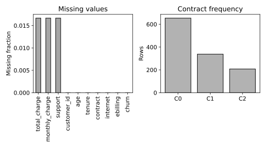

# 4.11 결측 분포와 범주별 관측 수 탐색

결측률과 범주별 표본 수를 구분하고 삭제·대치 전에 자료 상태를 기록한다.

## 실행

```bash
python sec_11_missingness.py
```

Python 3.12.14에서 정상 종료 확인. 장 폴더를 작업 위치로 삼아 실행하며, 프로그램은 스크립트 위치에서 입력 경로를 찾는다.

## 입력 자료

- `data/churn.csv`: 1200행, 10열. 난수 시드 20261016의 완전한 교육용 합성 고객 데이터. 실제 고객 자료를 복사·익명화한 것이 아니며 개인과 연결되지 않음. SYN 식별자는 생성 행 번호. 요금은 가상 단위. churn=1은 생성 확률에 따라 표집한 가상 이탈. 실제 고객 행동이나 기업 성능을 뜻하지 않는다.
- 열: customer_id, age, tenure, monthly_charge, total_charge, contract, internet, support, ebilling, churn
- SHA-256: `3ba7cb141cab2dd302272ec555adb04842cc5adafd44a9e3968b93bad8cec0d1`

## 소스와 해설

[프로그램 원본](sec_11_missingness.py)

시작 1~5행은 pathlib·sys와 공통 모듈의 경로 및 CSV/출력 폴더를 정한다. 입력은 스크립트 위치 기준이므로 사용자의 현재 작업 폴더와 분리된다.

- 7행 `pd.to_numeric`: 누적 요금이 숫자처럼 보여도 문자열이나 공백이 있으면 계산에 바로 쓸 수 없다. errors="coerce"는 변환 불가능한 값을 NaN으로 만들어 결측 집계에 포함한다.

- 8행 `missing=f.`: isna는 결측 위치의 불리언 표를 만들고 mean은 True=1, False=0으로 평균을 낸다. 이 비율의 분모는 각 열의 전체 행 수다.

- 13행 `counts=`: 범주 결측을 문자열 MISSING으로 바꾼 다음 value_counts를 적용해 결측 범주도 막대에 포함한다. 결측을 그냥 버린 빈도표와 결과 의미가 다르다.

- 15행 `set_xticks`: C0,C1 등은 긴 한국어 범주 이름이 축에서 겹치지 않도록 만든 표시 코드다. contract_codes에 실제 이름을 함께 저장해 표시 코드를 정량 등급으로 오해하지 않도록 한다.

- 18행 `report(`: duplicated는 현재 열 전체가 같은 행을 센다. 고객 ID가 같은데 다른 열이 다른 경우는 이 검사로 잡히지 않으므로 식별자 중복 검사도 별도로 해야 한다.

## 실제 실행 결과

```json
{
  "rows": 1200,
  "duplicate_rows": 0,
  "missing_fraction": {
    "total_charge": 0.016666666666666666,
    "monthly_charge": 0.016666666666666666,
    "support": 0.016666666666666666,
    "customer_id": 0.0,
    "age": 0.0,
    "tenure": 0.0,
    "contract": 0.0,
    "internet": 0.0,
    "ebilling": 0.0,
    "churn": 0.0
  },
  "contract_codes": {
    "C0": "monthly",
    "C1": "one_year",
    "C2": "two_year"
  }
}
```



왼쪽 분모는 전체 행 수다. 오른쪽 C0 등은 긴 범주명의 표시용 코드이며 의미는 JSON의 contract_codes에서 확인한다.

값의 부재 원인은 표만으로 알 수 없다. 결측률이 낮다고 무작위 결측이라고 단정하지 않는다.

## 확인 과제와 채점 기준

결측이 있는 열과 완전한 열을 구분하고, 행 삭제로 제외될 고객 유형이 무엇인지 적는다.

입력·분할·출처 확인 2점, 재실행과 산출물 일치 3점, 수치·그림 해석 3점, 한계와 실패 사례 설명 2점. 제출물은 변경 코드, 결과 CSV/JSON, 비교 그림, 5문장 해석이다.
