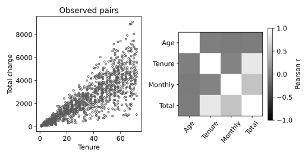

# 4.12 산점도·상관행렬·이상값 플래그 비교

단변량 이상값 후보, 두 변수의 관계, 여러 변수의 선형 상관을 함께 확인한다.

## 실행

```bash
python sec_12_correlation_outlier.py
```

Python 3.12.14에서 정상 종료 확인. 장 폴더를 작업 위치로 삼아 실행하며, 프로그램은 스크립트 위치에서 입력 경로를 찾는다.

## 입력 자료

- `data/churn.csv`: 1200행, 10열. 난수 시드 20261016의 완전한 교육용 합성 고객 데이터. 실제 고객 자료를 복사·익명화한 것이 아니며 개인과 연결되지 않음. SYN 식별자는 생성 행 번호. 요금은 가상 단위. churn=1은 생성 확률에 따라 표집한 가상 이탈. 실제 고객 행동이나 기업 성능을 뜻하지 않는다.
- 열: customer_id, age, tenure, monthly_charge, total_charge, contract, internet, support, ebilling, churn
- SHA-256: `3ba7cb141cab2dd302272ec555adb04842cc5adafd44a9e3968b93bad8cec0d1`

## 소스와 해설

[프로그램 원본](sec_12_correlation_outlier.py)

시작 1~5행은 pathlib·sys와 공통 모듈의 경로 및 CSV/출력 폴더를 정한다. 입력은 스크립트 위치 기준이므로 사용자의 현재 작업 폴더와 분리된다.

- 9행 `a=f[cols]`: 입력 특성 중 수치형 4개만 선택한다. 식별자 숫자를 의미 있는 연속형 변수처럼 상관행렬에 넣지 않는다.

- 10행 `q1,q3=`: Q1과 Q3는 25·75백분위수다. IQR=Q3−Q1이며 하한 Q1−1.5IQR, 상한 Q3+1.5IQR을 열마다 계산한다.

- 11행 `flag=`: 두 비교 결과를 |로 묶어 하한 미만 또는 상한 초과를 후보로 표시한다. 괄호가 없으면 연산 우선순위 때문에 의도와 다른 식이 될 수 있다. NaN은 자동으로 이상값이 되는 것이 아니다.

- 9행 `corr=a.corr`: Pearson 상관계수는 선형 관계를 요약한다. 결측이 포함된 경우 열 쌍별 사용 가능한 관측으로 계산되어 표본 수가 달라질 수 있다.

- 17행 `vmin=-1`: 상관계수 색 범위를 -1~1로 고정해 다른 자료의 행렬과 비교 가능한 눈금을 유지한다. 밝기만 보고 상관의 부호를 판단하지 말고 색 막대의 숫자를 확인한다.

## 실제 실행 결과

```json
{
  "iqr_flags": {
    "age": 0,
    "tenure": 0,
    "monthly_charge": 9,
    "total_charge": 5
  },
  "pairwise_corr_tenure_total": 0.8197286745425285
}
```



누적 요금과 이용 기간의 상관은 계산 방식에서 생길 수도 있다. 상관행렬은 열별 완전 관측 쌍으로 계산되므로 모든 칸의 표본 수가 같다고 가정하지 않는다.

IQR 경계는 오류 판정기가 아니다. 훈련 전처리에 쓸 경계라면 훈련 자료에서만 추정해야 한다.

## 확인 과제와 채점 기준

플래그가 붙은 행을 찾아 합법적 극단값인지 입력 오류인지 구분할 추가 근거를 제시한다.

입력·분할·출처 확인 2점, 재실행과 산출물 일치 3점, 수치·그림 해석 3점, 한계와 실패 사례 설명 2점. 제출물은 변경 코드, 결과 CSV/JSON, 비교 그림, 5문장 해석이다.
