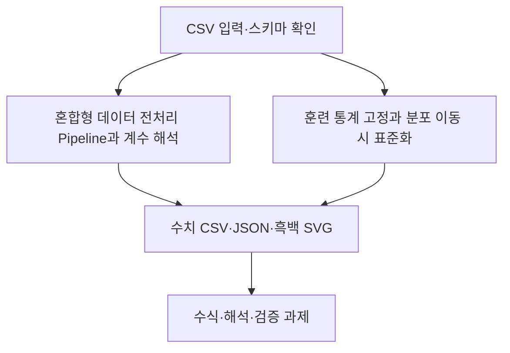

# 제5장 추가 실습

현재 Word 원고의 5.11절과 5.12절에 대응한다. 저장소의 기존 폴더 번호와 현재 Word 장 번호는 일부 다르므로 이 대응을 우선한다.

- [5.11 혼합형 데이터 전처리 Pipeline과 계수 해석](sec_11_mixed_pipeline.md) — [코드](sec_11_mixed_pipeline.py)
- [5.12 훈련 통계 고정과 분포 이동 시 표준화](sec_12_shift_scaler.md) — [코드](sec_12_shift_scaler.py)

[통합 Jupyter 노트북](chapter_practice.ipynb) · [데이터 카드](data_card.json) · [편집 가능한 과정 원본](process.mmd)

