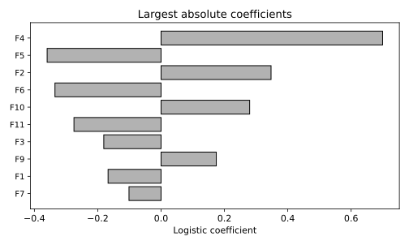

# 5.11 혼합형 데이터 전처리 Pipeline과 계수 해석

수치형과 범주형 열을 다른 절차로 바꾼 뒤 한 분류기로 연결한다.

## 실행

```bash
python sec_11_mixed_pipeline.py
```

Python 3.12.14에서 정상 종료 확인. 장 폴더를 작업 위치로 삼아 실행하며, 프로그램은 스크립트 위치에서 입력 경로를 찾는다.

## 입력 자료

- `data/churn.csv`: 1200행, 10열. 난수 시드 20261016의 완전한 교육용 합성 고객 데이터. 실제 고객 자료를 복사·익명화한 것이 아니며 개인과 연결되지 않음. SYN 식별자는 생성 행 번호. 요금은 가상 단위. churn=1은 생성 확률에 따라 표집한 가상 이탈. 실제 고객 행동이나 기업 성능을 뜻하지 않는다.
- 열: customer_id, age, tenure, monthly_charge, total_charge, contract, internet, support, ebilling, churn
- SHA-256: `3ba7cb141cab2dd302272ec555adb04842cc5adafd44a9e3968b93bad8cec0d1`

## 소스와 해설

[프로그램 원본](sec_11_mixed_pipeline.py)

시작 1~5행은 pathlib·sys와 공통 모듈의 경로 및 CSV/출력 폴더를 정한다. 입력은 스크립트 위치 기준이므로 사용자의 현재 작업 폴더와 분리된다.

- 15행 `num=[`: num과 cat은 서로 다른 전처리 대상 열 목록이다. 고객 ID와 이탈 정답은 목록에 포함하지 않는다. 목표를 입력에 넣는 누수를 피하는 첫 단계다.

- 20행 `pre=ColumnTransformer`: num 분기는 훈련 중앙값으로 결측을 채우고 표준화한다. cat 분기는 최빈값 대치와 One-Hot Encoding(원-핫 인코딩)을 수행한다. 변환 결과는 열 방향으로 결합된다.

- 24행 `handle_unknown`: 훈련 때 못 본 범주가 들어오면 오류 대신 그 범주 열들의 0 벡터를 만든다. 새 범주를 학습하거나 의미를 추정한 것은 아니므로 빈도와 품질을 감시해야 한다.

- 26행 `model.fit`: Pipeline 전체를 훈련 분할에 fit하고 테스트에는 predict만 호출한다. 테스트의 결측 대치 값이나 범주 목록을 학습에 이용하지 않는다.

- 27행 `names=model`: get_feature_names_out이 변환 후 열의 실제 순서를 돌려준다. coef_[0]의 같은 위치와 맞추어야 특정 원-핫 범주에 다른 계수를 붙이는 오류를 피할 수 있다.

## 실제 실행 결과

```json
{
  "train_n": 840,
  "test_n": 360,
  "transformed_features": 14,
  "figure_feature_codes": {
    "F7": "cat__internet_dsl",
    "F1": "num__tenure",
    "F9": "cat__internet_none",
    "F3": "num__total_charge",
    "F11": "cat__support_yes",
    "F10": "cat__support_no",
    "F6": "cat__contract_two_year",
    "F2": "num__monthly_charge",
    "F5": "cat__contract_one_year",
    "F4": "cat__contract_monthly"
  },
  "accuracy": 0.7916666666666666,
  "f1": 0.025974025974025976
}
```



계수의 부호는 다른 열이 고정된 선형 로그 오즈 효과다. 범주형 전체 더미와 정규화를 썼으므로 단순 인과효과나 절대 중요도로 읽지 않는다.

이탈 열과 고객 ID는 입력에서 제외했다. 총요금의 예측 시점 이용 가능성은 실제 업무에서 별도 확인해야 한다.

## 확인 과제와 채점 기준

새 범주가 들어 있는 한 행을 만들어 predict가 실패하지 않는지 확인하고 출력 열 이름과 계수 수를 맞춘다.

입력·분할·출처 확인 2점, 재실행과 산출물 일치 3점, 수치·그림 해석 3점, 한계와 실패 사례 설명 2점. 제출물은 변경 코드, 결과 CSV/JSON, 비교 그림, 5문장 해석이다.
