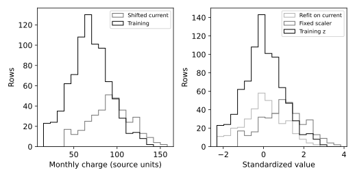

# 5.12 훈련 통계 고정과 분포 이동 시 표준화

훈련에서 정한 평균·표준편차를 운영 입력에도 재사용하는 이유를 실험한다.

## 실행

```bash
python sec_12_shift_scaler.py
```

Python 3.12.14에서 정상 종료 확인. 장 폴더를 작업 위치로 삼아 실행하며, 프로그램은 스크립트 위치에서 입력 경로를 찾는다.

## 입력 자료

- `data/churn.csv`: 1200행, 10열. 난수 시드 20261016의 완전한 교육용 합성 고객 데이터. 실제 고객 자료를 복사·익명화한 것이 아니며 개인과 연결되지 않음. SYN 식별자는 생성 행 번호. 요금은 가상 단위. churn=1은 생성 확률에 따라 표집한 가상 이탈. 실제 고객 행동이나 기업 성능을 뜻하지 않는다.
- 열: customer_id, age, tenure, monthly_charge, total_charge, contract, internet, support, ebilling, churn
- SHA-256: `3ba7cb141cab2dd302272ec555adb04842cc5adafd44a9e3968b93bad8cec0d1`

## 소스와 해설

[프로그램 원본](sec_12_shift_scaler.py)

시작 1~5행은 pathlib·sys와 공통 모듈의 경로 및 CSV/출력 폴더를 정한다. 입력은 스크립트 위치 기준이므로 사용자의 현재 작업 폴더와 분리된다.

- 11행 `a,b=train_test_split`: 표준화의 기준 분포와 이후 관측 분포를 분리하기 위한 행 번호 분할이다. 이 실험에는 목표값 y나 분류기 학습이 없으므로 정답 분포를 보존하는 stratify는 쓰지 않는다.

- 15행 `current["monthly_charge"]+=25`: 현재 관측에만 25를 더해 입력 이동을 의도적으로 만든다. 원래 파일에 기록된 실제 변화로 보고하면 안 된다. copy로 분리했으므로 원 데이터프레임 전체를 덮어쓰지 않는다.

- 17행 `z_train=`: fit_transform은 중앙값·평균·표준편차를 훈련에서 정하고 훈련 값을 변환한다. z_current에는 transform만 사용해 같은 좌표계로 이동 크기를 비교한다.

- 20행 `z_refit=`: 잘못된 운영 방식의 대조 예로 현재 분포에 새 전처리기를 fit한다. 이 값이 0 근처의 평균으로 보인다고 분포 이동이 사라진 것은 아니다.

- 31행 `report(`: 결과 평균은 변환 후 좌표 평균이다. 이는 분류 성능·정답 정확도·드리프트 경보 임계값을 나타내지 않는다. 변환을 바꾸면 저장된 모델과의 호환성도 재검증해야 한다.

## 실제 실행 결과

```json
{
  "training_mean": -1.6917684184764292e-17,
  "current_fixed_mean": 0.9820481867102312,
  "current_refit_mean": 8.437694987151189e-16
}
```



오른쪽의 현재 자료 재적합은 평균 이동을 0 근처로 지워 버린다. 두 방식은 같은 숫자 좌표를 보장하지 않는다.

+25는 의도적으로 만든 가정 시나리오다. 새 모델을 평가하거나 전처리 누수의 성능 이득을 측정한 실험이 아니다.

## 확인 과제와 채점 기준

+25를 +0으로 바꾸고 두 변환의 차이를 다시 기록한다. 운영 전처리를 재적합하려면 모델도 함께 검증해야 함을 설명한다.

입력·분할·출처 확인 2점, 재실행과 산출물 일치 3점, 수치·그림 해석 3점, 한계와 실패 사례 설명 2점. 제출물은 변경 코드, 결과 CSV/JSON, 비교 그림, 5문장 해석이다.
