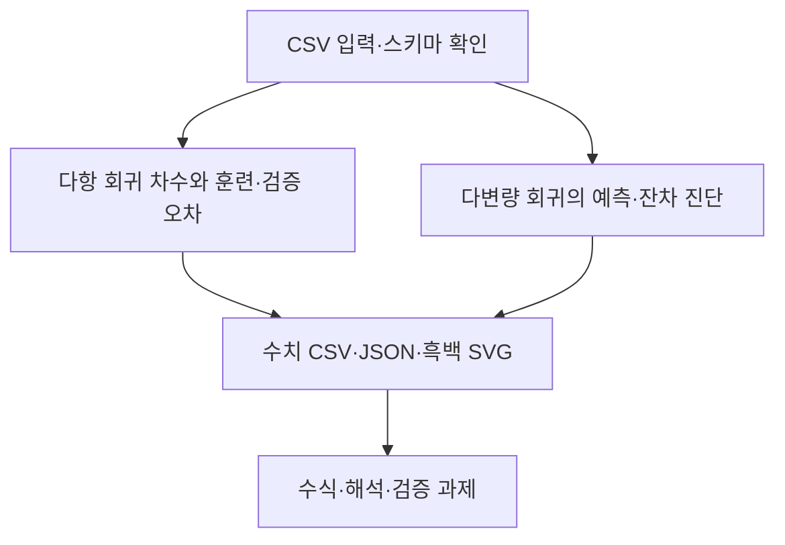

# 제6장 추가 실습

현재 Word 원고의 6.11절과 6.12절에 대응한다. 저장소의 기존 폴더 번호와 현재 Word 장 번호는 일부 다르므로 이 대응을 우선한다.

- [6.11 다항 회귀 차수와 훈련·검증 오차](sec_11_polynomial_complexity.md) — [코드](sec_11_polynomial_complexity.py)
- [6.12 다변량 회귀의 예측·잔차 진단](sec_12_regression_residual.md) — [코드](sec_12_regression_residual.py)

[통합 Jupyter 노트북](chapter_practice.ipynb) · [데이터 카드](data_card.json) · [편집 가능한 과정 원본](process.mmd)

[6.13 열별 데이터 사전과 검증 기준](dataset_guide.md) · [계산된 통계 JSON](data_profile.json)
