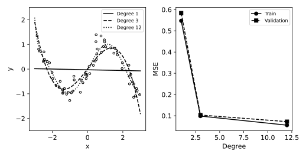

# 6.11 다항 회귀 차수와 훈련·검증 오차

모델 복잡도 변화가 함수 형태와 훈련·검증 오차에 어떤 영향을 주는지 연결한다.

## 실행

```bash
python sec_11_polynomial_complexity.py
```

Python 3.12.14에서 정상 종료 확인. 장 폴더를 작업 위치로 삼아 실행하며, 프로그램은 스크립트 위치에서 입력 경로를 찾는다.

## 입력 자료

- `data/nonlinear.csv`: 100행, 2열. 난수 시드 42의 교육용 합성 비선형 회귀. 실제 측정값 아님. x 입력, y=sin(1.5x)+잡음. 다항식 차수와 과적합 비교. 단위 없음.
- 열: x, y
- SHA-256: `dc5366f8949e175cb60f3e47303e801e1593732fedda4c469b8a34671ed70ba5`

## 소스와 해설

[프로그램 원본](sec_11_polynomial_complexity.py)

시작 1~5행은 pathlib·sys와 공통 모듈의 경로 및 CSV/출력 폴더를 정한다. 입력은 스크립트 위치 기준이므로 사용자의 현재 작업 폴더와 분리된다.

- 12행 `tr,va=`: 검증 표본은 차수별 비교에 공통으로 사용한다. 이 점수를 보고 차수를 선택하는 순간 해당 자료는 최종 테스트가 아니라 모델 개발 자료가 된다.

- 7행 `PolynomialFeatures`: 원 입력 x를 x,x²,…,x의 degree제곱으로 확장한다. include_bias=False는 상수 1열을 제외하며 Ridge의 절편과 불필요하게 중복하지 않는다.

- 18행 `StandardScaler(),Ridge`: 높은 차수 열의 크기가 급격히 커지므로 훈련 변환 후 표준화한다. Ridge는 계수 크기에 L2 벌점을 주며 alpha가 벌점의 세기를 조정한다.

- 10행 `mean_squared_error`: 훈련 오차와 검증 오차는 각각 해당 분할의 실제값·예측값으로 별도 계산한다. 훈련 오차가 낮다는 이유만으로 차수를 고르지 않는다.

- 24행 `ylim=(-2.5,2.5)`: 세 곡선의 중심 영역을 비교하기 위한 표시 범위다. 이 범위를 벗어나는 예측값은 그림에서 잘릴 수 있지만 CSV의 오차 계산에서는 제외되지 않는다.

## 실제 실행 결과

```json
{
  "train_n": 65,
  "validation_n": 35,
  "comparison": [
    {
      "degree": 1,
      "train_mse": 0.5473315381283144,
      "validation_mse": 0.5837276886715528
    },
    {
      "degree": 3,
      "train_mse": 0.09840338772961127,
      "validation_mse": 0.10333037320461691
    },
    {
      "degree": 12,
      "train_mse": 0.0555680496892883,
      "validation_mse": 0.07235448274809285
    }
  ]
}
```



곡선은 같은 훈련 자료로 학습했다. 차수 12가 반드시 과적합한다는 결론을 미리 정하지 않고 실제 검증 오차를 비교한다.

이 분할은 모델 선택에 쓰는 검증 세트다. 최종 테스트 세트가 아니며 가장 좋은 차수를 고른 뒤의 일반화 성능은 별도 평가해야 한다.

## 확인 과제와 채점 기준

alpha를 0.01, 1, 100으로 바꾸어 정규화가 곡선과 오차에 미치는 영향을 기록한다.

입력·분할·출처 확인 2점, 재실행과 산출물 일치 3점, 수치·그림 해석 3점, 한계와 실패 사례 설명 2점. 제출물은 변경 코드, 결과 CSV/JSON, 비교 그림, 5문장 해석이다.
