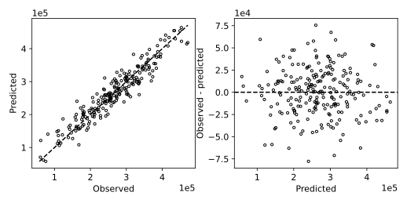

# 6.12 다변량 회귀의 예측·잔차 진단

평가 수치 하나와 예측·잔차의 시각적 진단을 함께 확인한다.

## 실행

```bash
python sec_12_regression_residual.py
```

Python 3.12.14에서 정상 종료 확인. 장 폴더를 작업 위치로 삼아 실행하며, 프로그램은 스크립트 위치에서 입력 경로를 찾는다.

## 입력 자료

- `data/housing.csv`: 900행, 6열. 기존 GitHub 06_Regression/housing_regression.csv를 열 이름만 바꾼 자료. 실측·합성 여부와 원 단위는 미확인. price를 목표로 사용. area, rooms, age, distance, school_score는 입력. 가격 단위를 임의로 원으로 부르지 않는다.
- 열: area, rooms, age, distance, school_score, price
- SHA-256: `d25be46f3069abd79501e8315ef866d9e9c8915b49b4899a62d16763ba61c88a`

## 소스와 해설

[프로그램 원본](sec_12_regression_residual.py)

시작 1~5행은 pathlib·sys와 공통 모듈의 경로 및 CSV/출력 폴더를 정한다. 입력은 스크립트 위치 기준이므로 사용자의 현재 작업 폴더와 분리된다.

- 12행 `X=f.drop`: price 열을 제거한 나머지 다섯 열을 입력으로 사용한다. y와 X의 행 번호가 일치하도록 같은 분할 인덱스로 선택한다.

- 7행 `make_pipeline`: 중앙값 대치·표준화·Ridge를 함께 학습한다. 순서가 바뀌면 결측 상태로 표준화나 회귀기에 들어갈 수 있으므로 처리 순서도 모델의 일부다.

- 16행 `residual=true-pred`: 잔차의 부호를 실제−예측으로 고정한다. 양수는 과소 예측, 음수는 과대 예측이다. 학습 때 정의한 예측−실제 오차와 부호가 반대여도 제곱오차는 같다.

- 21행 `lims=[`: 실제값과 예측값의 공통 최소·최대에 맞춘 y=x 선을 그린다. 선 위의 점은 정확한 예측을 나타내며 Pearson 상관계수가 높다는 것만으로 이 선에 가깝다는 뜻은 아니다.

- 29행 `report(`: MAE는 절대오차의 평균, RMSE는 MSE의 제곱근, R²는 상수 평균 기준 대비 설명 개선을 요약한다. 지표들의 단위와 기준이 다르므로 숫자 크기만 비교하지 않는다.

## 실제 실행 결과

```json
{
  "test_n": 225,
  "MAE": 21262.236678422567,
  "RMSE": 26904.542907001793,
  "R2": 0.8993479315644811
}
```



대각선 위쪽은 과대 예측이다. 잔차는 실제값−예측값으로 정의했으므로 오른쪽 양수는 과소 예측을 뜻한다.

오차의 단위는 원 자료의 price 단위다. 금액 단위가 확인되지 않아 원·만원이라고 임의 표기하지 않는다.

## 확인 과제와 채점 기준

최대 절대 잔차 행을 찾아 입력 특성과 결측을 확인하고 새로운 원인 가설을 2개 쓴다.

입력·분할·출처 확인 2점, 재실행과 산출물 일치 3점, 수치·그림 해석 3점, 한계와 실패 사례 설명 2점. 제출물은 변경 코드, 결과 CSV/JSON, 비교 그림, 5문장 해석이다.
