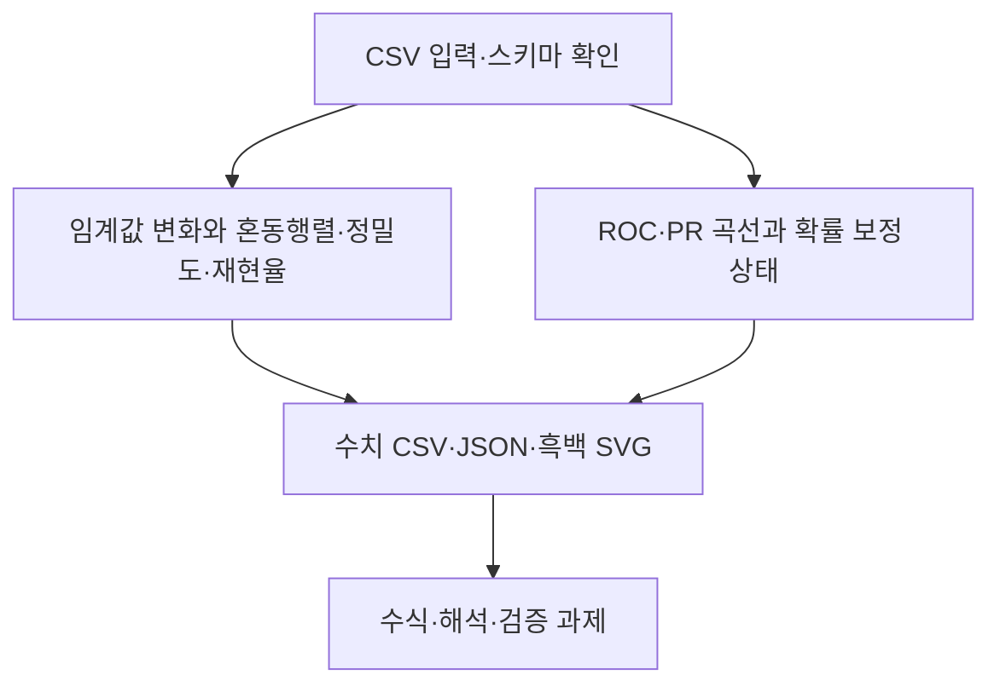

# 제7장 추가 실습

현재 Word 원고의 7.11절과 7.12절에 대응한다. 저장소의 기존 폴더 번호와 현재 Word 장 번호는 일부 다르므로 이 대응을 우선한다.

- [7.11 임계값 변화와 혼동행렬·정밀도·재현율](sec_11_threshold_metrics.md) — [코드](sec_11_threshold_metrics.py)
- [7.12 ROC·PR 곡선과 확률 보정 상태](sec_12_roc_pr.md) — [코드](sec_12_roc_pr.py)

[통합 Jupyter 노트북](chapter_practice.ipynb) · [데이터 카드](data_card.json) · [편집 가능한 과정 원본](process.mmd)

[7.13 열별 데이터 사전과 검증 기준](dataset_guide.md) · [계산된 통계 JSON](data_profile.json)
