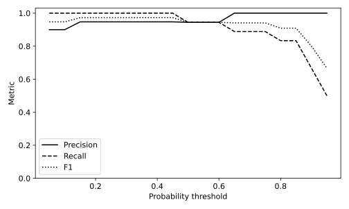

# 7.11 임계값 변화와 혼동행렬·정밀도·재현율

같은 확률 예측을 여러 임계값으로 바꾸어 지표 수식과 혼동행렬을 일대일로 대응한다.

## 실행

```bash
python sec_11_threshold_metrics.py
```

Python 3.12.14에서 정상 종료 확인. 장 폴더를 작업 위치로 삼아 실행하며, 프로그램은 스크립트 위치에서 입력 경로를 찾는다.

## 입력 자료

- `data/wine.csv`: 178행, 14열. scikit-learn 내장 Wine 데이터(load_wine), UCI Wine에서 유래한 178개 관측. 생성 자료 아님. 13개 연속형 화학 분석 특성과 target(0,1,2). 7장은 target==0을 양성으로 재정의한다. 물리 단위는 원 출처 설명을 확인한다.
- 열: alcohol, malic_acid, ash, alcalinity_of_ash, magnesium, total_phenols, flavanoids, nonflavanoid_phenols, proanthocyanins, color_intensity, hue, od280_od315_of_diluted_wines, proline, target
- SHA-256: `47946bdb6b5017961c6e2b5daa8a74b0d98779c1c66f21645d1d737eded7e8cb`

## 소스와 해설

[프로그램 원본](sec_11_threshold_metrics.py)

시작 1~5행은 pathlib·sys와 공통 모듈의 경로 및 CSV/출력 폴더를 정한다. 입력은 스크립트 위치 기준이므로 사용자의 현재 작업 폴더와 분리된다.

- 11행 `y=(f.target`: 원래 3개 품종 중 클래스 0을 양성 1로 바꾸고 나머지를 음성 0으로 합친다. 원래 target 0이라는 표기와 평가용 양성 1이라는 표기를 혼동하지 않는다.

- 14행 `predict_proba`: [:,1]은 정렬된 클래스 중 양성 클래스 1의 확률 열이다. 다중분류에서 무조건 두 번째 열이 관심 양성이라는 가정은 성립하지 않으므로 classes_를 확인해야 한다.

- 17행 `pred=(p>=`: 확률이 threshold 이상이면 양성으로 판정한다. >=에는 경계값을 포함한다는 뜻이 있다. 임계값이 바뀌어도 학습된 가중치나 확률 예측은 다시 학습하지 않는다.

- 17행 `tn,fp,fn,tp=`: labels=[0,1]은 행·열 순서를 음성,양성으로 고정한다. 행은 실제값, 열은 예측값이다. 펼친 순서가 TN,FP,FN,TP가 되므로 다른 순서로 변수에 넣지 않는다.

- 19행 `zero_division=0`: 양성 예측이 없거나 실제 양성이 없어 분모가 0이 되는 경우를 0으로 처리하는 규칙이다. 수학적으로 정보가 충분한 관측과 같게 보지 말고 해당 혼동행렬의 개수도 함께 확인한다.

## 실제 실행 결과

```json
{
  "validation_n": 54,
  "positive_definition": "wine target == 0",
  "at_threshold_0.5": {
    "threshold": 0.49999999999999994,
    "TN": 35,
    "FP": 1,
    "FN": 1,
    "TP": 17,
    "Accuracy": 0.9629629629629629,
    "Precision": 0.9444444444444444,
    "Recall": 0.9444444444444444,
    "F1": 0.9444444444444444
  }
}
```



양성은 Wine 원래 클래스 0이다. 임계값을 올리면 양성 예측 집합은 줄어든다. 정밀도는 반드시 단조 증가하지 않는다.

임계값 선택용 검증 자료다. 최적 F1을 고른 뒤 같은 세트의 점수를 최종 테스트 성능으로 보고하지 않는다.

## 확인 과제와 채점 기준

CSV에서 임계값 0.5의 TP·FP·FN·TN으로 네 지표를 직접 계산해 JSON과 대조한다.

입력·분할·출처 확인 2점, 재실행과 산출물 일치 3점, 수치·그림 해석 3점, 한계와 실패 사례 설명 2점. 제출물은 변경 코드, 결과 CSV/JSON, 비교 그림, 5문장 해석이다.
