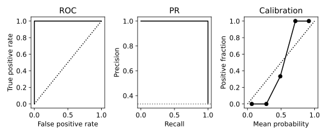

# 7.12 ROC·PR 곡선과 확률 보정 상태

분류 순위 능력과 확률의 신뢰도를 다른 관점으로 읽는다.

## 실행

```bash
python sec_12_roc_pr.py
```

Python 3.12.14에서 정상 종료 확인. 장 폴더를 작업 위치로 삼아 실행하며, 프로그램은 스크립트 위치에서 입력 경로를 찾는다.

## 입력 자료

- `data/wine.csv`: 178행, 14열. scikit-learn 내장 Wine 데이터(load_wine), UCI Wine에서 유래한 178개 관측. 생성 자료 아님. 13개 연속형 화학 분석 특성과 target(0,1,2). 7장은 target==0을 양성으로 재정의한다. 물리 단위는 원 출처 설명을 확인한다.
- 열: alcohol, malic_acid, ash, alcalinity_of_ash, magnesium, total_phenols, flavanoids, nonflavanoid_phenols, proanthocyanins, color_intensity, hue, od280_od315_of_diluted_wines, proline, target
- SHA-256: `47946bdb6b5017961c6e2b5daa8a74b0d98779c1c66f21645d1d737eded7e8cb`

## 소스와 해설

[프로그램 원본](sec_12_roc_pr.py)

시작 1~5행은 pathlib·sys와 공통 모듈의 경로 및 CSV/출력 폴더를 정한다. 입력은 스크립트 위치 기준이므로 사용자의 현재 작업 폴더와 분리된다.

- 14행 `C=.1`: 로지스틱 회귀의 C는 정규화 세기의 역수다. 이 예에서는 비교 중 설정을 바꾸지 않았으며 보정 곡선을 보고 C를 최적화하지 않는다.

- 10행 `roc_curve`: 각 임계값에서 FPR=FP/(FP+TN), TPR=TP/(TP+FN)을 계산한다. ROC의 대각선은 무작위 순위 판별의 참고선이며 확률 보정의 기준선과 다른 뜻이다.

- 10행 `precision_recall_curve`: 정밀도·재현율의 좌표를 반환한다. Average Precision은 재현율 증가에 따른 정밀도의 가중 요약이며 모든 PR 선의 단순 사다리꼴 면적과 항상 같지는 않다.

- 11행 `calibration_curve`: 확률 구간별 평균 예측과 관측 양성 비율을 계산한다. 반환된 점 수가 n_bins보다 적으면 관측이 없는 빈 구간을 생략한 것이다.

- 30행 `Brier`: Brier score는 평균 (p−y)²로 계산한다. 값이 작을수록 확률 오차가 작다. AUC는 양성 순위의 구분 능력이고 정확한 확률 숫자와 동일한 성질이 아니다.

## 실제 실행 결과

```json
{
  "test_n": 54,
  "prevalence": 0.3333333333333333,
  "ROC_AUC": 1.0,
  "AP": 1.0000000000000002,
  "Brier": 0.027331693273780305
}
```



ROC는 FPR/TPR, PR은 Recall/Precision이다. 보정 곡선은 구간 평균 확률과 실제 양성 비율을 비교한다. 비어 있는 구간은 표시되지 않는다.

작은 테스트 세트와 구간화 결과는 불안정할 수 있다. 보정 곡선 자체가 보정 처리를 수행한 것은 아니다.

## 확인 과제와 채점 기준

PR 기준선이 양성 비율인 이유를 설명하고, Brier 점수와 AUC 중 어느 지표가 확률 오차를 직접 반영하는지 구분한다.

입력·분할·출처 확인 2점, 재실행과 산출물 일치 3점, 수치·그림 해석 3점, 한계와 실패 사례 설명 2점. 제출물은 변경 코드, 결과 CSV/JSON, 비교 그림, 5문장 해석이다.
