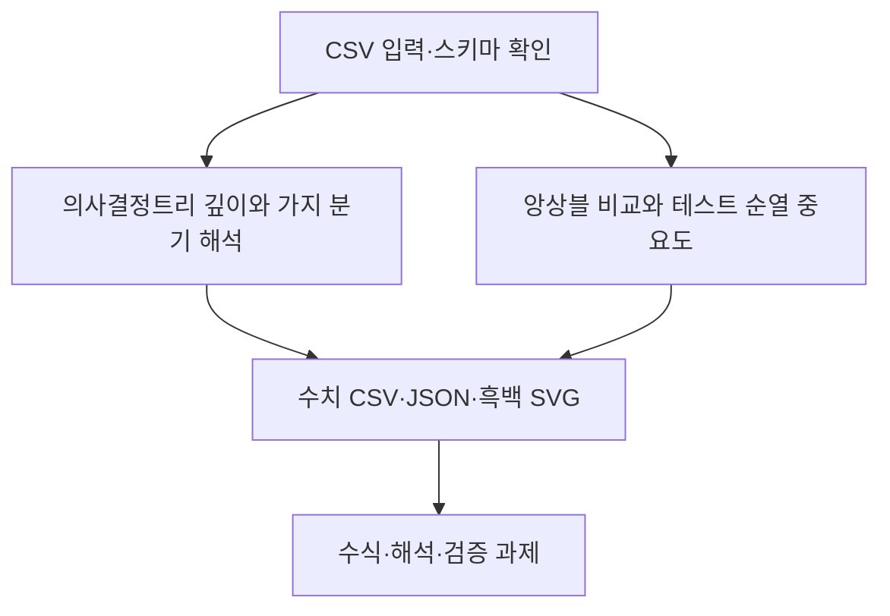

# 제8장 추가 실습

현재 Word 원고의 8.11절과 8.12절에 대응한다. 저장소의 기존 폴더 번호와 현재 Word 장 번호는 일부 다르므로 이 대응을 우선한다.

- [8.11 의사결정트리 깊이와 가지 분기 해석](sec_11_tree_depth.md) — [코드](sec_11_tree_depth.py)
- [8.12 앙상블 비교와 테스트 순열 중요도](sec_12_ensemble_importance.md) — [코드](sec_12_ensemble_importance.py)

[통합 Jupyter 노트북](chapter_practice.ipynb) · [데이터 카드](data_card.json) · [편집 가능한 과정 원본](process.mmd)

[8.13 열별 데이터 사전과 검증 기준](dataset_guide.md) · [계산된 통계 JSON](data_profile.json)
