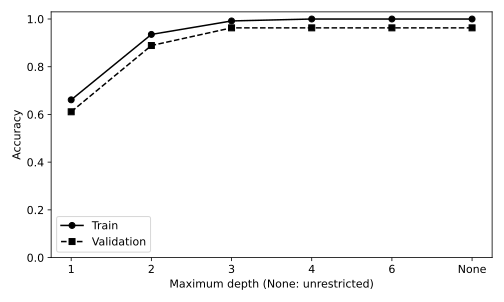
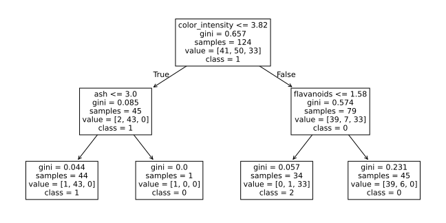

# 8.11 의사결정트리 깊이와 가지 분기 해석

트리 깊이에 따른 훈련·검증 차이와 실제 분기 조건을 연결한다.

## 실행

```bash
python sec_11_tree_depth.py
```

Python 3.12.14에서 정상 종료 확인. 장 폴더를 작업 위치로 삼아 실행하며, 프로그램은 스크립트 위치에서 입력 경로를 찾는다.

## 입력 자료

- `data/wine.csv`: 178행, 14열. scikit-learn 내장 Wine 데이터(load_wine), UCI Wine에서 유래한 178개 관측. 생성 자료 아님. 13개 연속형 화학 분석 특성과 target(0,1,2). 7장은 target==0을 양성으로 재정의한다. 물리 단위는 원 출처 설명을 확인한다.
- 열: alcohol, malic_acid, ash, alcalinity_of_ash, magnesium, total_phenols, flavanoids, nonflavanoid_phenols, proanthocyanins, color_intensity, hue, od280_od315_of_diluted_wines, proline, target
- SHA-256: `47946bdb6b5017961c6e2b5daa8a74b0d98779c1c66f21645d1d737eded7e8cb`

## 소스와 해설

[프로그램 원본](sec_11_tree_depth.py)

시작 1~5행은 pathlib·sys와 공통 모듈의 경로 및 CSV/출력 폴더를 정한다. 입력은 스크립트 위치 기준이므로 사용자의 현재 작업 폴더와 분리된다.

- 12행 `for depth in`: 깊이를 1·2·3·4·6과 무제한으로 바꾸어 같은 훈련·검증 분할에서 비교한다. 깊이 제한이 없어도 동일 입력에서는 노드 수가 유한하며 최소 표본 등의 규칙에 따라 분기가 멈춘다.

- 15행 `m.tree_.node_count`: 최종 생성된 내부 노드와 잎의 전체 개수다. max_depth 값 자체와 같지 않으며 트리가 완전 이진트리 모양으로 모두 채워질 필요도 없다.

- 24행 `small=`: 해석 그림을 위해 깊이 2 모델을 별도로 만든다. 비교에서 최고 정확도의 깊이를 자동 선택한 그림이라고 오해하지 않도록 구조 그림의 설정을 명시한다.

- 7행 `plot_tree`: 분기 조건·Gini 불순도·훈련 관측 수와 클래스 분포를 표시한다. scikit-learn 버전에 따라 value가 정규화 비율로 표시될 수 있으므로 samples와 합이 다르다는 이유만으로 오류로 보지 않는다.

- 29행 `report(`: comparison에는 각 깊이의 두 정확도와 노드 수를 모두 남긴다. 같은 검증 세트를 반복 확인한 결과이므로 보고한 최고값을 최종 테스트 성능으로 바꾸어 부르지 않는다.

## 실제 실행 결과

```json
{
  "validation_n": 54,
  "comparison": [
    {
      "depth_label": "1",
      "nodes": 3,
      "train_accuracy": 0.6612903225806451,
      "validation_accuracy": 0.6111111111111112
    },
    {
      "depth_label": "2",
      "nodes": 7,
      "train_accuracy": 0.9354838709677419,
      "validation_accuracy": 0.8888888888888888
    },
    {
      "depth_label": "3",
      "nodes": 13,
      "train_accuracy": 0.9919354838709677,
      "validation_accuracy": 0.9629629629629629
    },
    {
      "depth_label": "4",
      "nodes": 15,
      "train_accuracy": 1.0,
      "validation_accuracy": 0.9629629629629629
    },
    {
      "depth_label": "6",
      "nodes": 15,
      "train_accuracy": 1.0,
      "validation_accuracy": 0.9629629629629629
    },
    {
      "depth_label": "None",
      "nodes": 15,
      "train_accuracy": 1.0,
      "validation_accuracy": 0.9629629629629629
    }
  ]
}
```





구조 그림은 깊이 2의 별도 트리다. 조건이 참이면 왼쪽 자식, 거짓이면 오른쪽 자식으로 내려간다. value는 해당 훈련 노드의 클래스 분포다.

깊이 비교는 검증을 통한 모델 선택이다. 노드의 훈련 분포가 새로운 모집단의 확률을 그대로 의미하지는 않는다.

## 확인 과제와 채점 기준

한 테스트 행을 선택해 각 분기 조건을 대입하고 도달 잎의 예측을 predict와 비교한다.

입력·분할·출처 확인 2점, 재실행과 산출물 일치 3점, 수치·그림 해석 3점, 한계와 실패 사례 설명 2점. 제출물은 변경 코드, 결과 CSV/JSON, 비교 그림, 5문장 해석이다.
