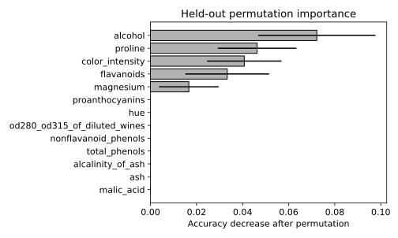

# 8.12 앙상블 비교와 테스트 순열 중요도

서로 다른 앙상블을 동일 분할에서 비교하고 열을 섞을 때 예측 성능이 얼마나 떨어지는지 본다.

## 실행

```bash
python sec_12_ensemble_importance.py
```

Python 3.12.14에서 정상 종료 확인. 장 폴더를 작업 위치로 삼아 실행하며, 프로그램은 스크립트 위치에서 입력 경로를 찾는다.

## 입력 자료

- `data/wine.csv`: 178행, 14열. scikit-learn 내장 Wine 데이터(load_wine), UCI Wine에서 유래한 178개 관측. 생성 자료 아님. 13개 연속형 화학 분석 특성과 target(0,1,2). 7장은 target==0을 양성으로 재정의한다. 물리 단위는 원 출처 설명을 확인한다.
- 열: alcohol, malic_acid, ash, alcalinity_of_ash, magnesium, total_phenols, flavanoids, nonflavanoid_phenols, proanthocyanins, color_intensity, hue, od280_od315_of_diluted_wines, proline, target
- SHA-256: `47946bdb6b5017961c6e2b5daa8a74b0d98779c1c66f21645d1d737eded7e8cb`

## 소스와 해설

[프로그램 원본](sec_12_ensemble_importance.py)

시작 1~5행은 pathlib·sys와 공통 모듈의 경로 및 CSV/출력 폴더를 정한다. 입력은 스크립트 위치 기준이므로 사용자의 현재 작업 폴더와 분리된다.

- 12행 `models={`: RandomForest는 여러 무작위 트리를 평균·투표로 결합하고 GradientBoosting은 앞선 모델의 오류를 보완하는 순차 단계를 쌓는다. 두 방법의 n_estimators가 같더라도 계산량과 구조는 동일하지 않다.

- 15행 `for name,m`: 두 모델은 동일 입력 열과 동일 훈련·테스트 번호를 사용한다. 한 모델에만 다른 분할을 쓰면 알고리즘 차이와 표본 차이를 분리하기 어렵다.

- 8행 `permutation_importance`: 테스트의 한 특성 열을 무작위로 섞고 정확도의 감소를 측정한다. 모델을 다시 학습하는 것이 아니라 이미 학습한 모델이 해당 열의 연결 관계에 얼마나 의존하는지 확인한다.

- 20행 `n_repeats=10`: 열별로 10번 섞어 중요도 평균과 표준편차를 구한다. n_jobs=1은 작은 실습에서 자원 사용과 실행 재현 조건을 단순하게 유지한다.

- 24행 `xerr=r.std_drop`: 오차 막대는 순열 반복 간 표준편차다. 음수 평균은 섞은 후 점수가 더 좋아진 경우를 뜻할 수 있으며 그 변수가 인과적으로 해롭다는 결론은 아니다.

## 실제 실행 결과

```json
{
  "test_n": 54,
  "accuracy": {
    "RandomForest": 1.0,
    "GradientBoosting": 0.9629629629629629
  }
}
```



막대는 정확도 감소의 반복 평균이고 오차 막대는 반복 표준편차다. 신뢰구간이 아니며 음수가 나올 수도 있다.

테스트 중요도로 특성을 선택하면 이 테스트는 모델 개발에 사용된 것이 된다. 다음 모델의 최종 성능은 새로운 홀드아웃이 필요하다.

## 확인 과제와 채점 기준

상관된 두 특성이 중요도를 나누어 가질 수 있는 이유와 노드 불순도 중요도와의 차이를 설명한다.

입력·분할·출처 확인 2점, 재실행과 산출물 일치 3점, 수치·그림 해석 3점, 한계와 실패 사례 설명 2점. 제출물은 변경 코드, 결과 CSV/JSON, 비교 그림, 5문장 해석이다.
