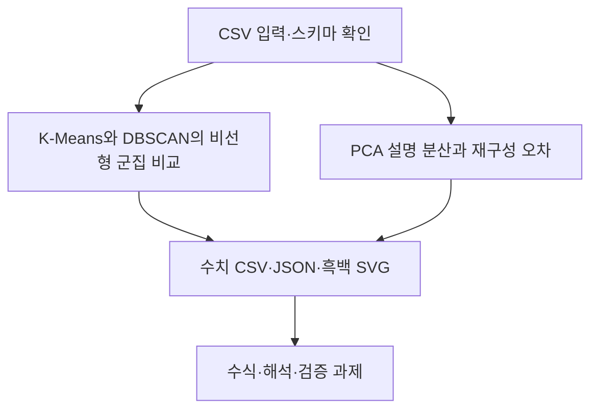

# 제9장 추가 실습

현재 Word 원고의 9.11절과 9.12절에 대응한다. 저장소의 기존 폴더 번호와 현재 Word 장 번호는 일부 다르므로 이 대응을 우선한다.

- [9.11 K-Means와 DBSCAN의 비선형 군집 비교](sec_11_clustering_compare.md) — [코드](sec_11_clustering_compare.py)
- [9.12 PCA 설명 분산과 재구성 오차](sec_12_pca_reconstruction.md) — [코드](sec_12_pca_reconstruction.py)

[통합 Jupyter 노트북](chapter_practice.ipynb) · [데이터 카드](data_card.json) · [편집 가능한 과정 원본](process.mmd)

[9.13 열별 데이터 사전과 검증 기준](dataset_guide.md) · [계산된 통계 JSON](data_profile.json)
