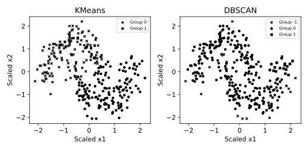

# 9.11 K-Means와 DBSCAN의 비선형 군집 비교

중심까지의 거리와 밀도 연결이라는 서로 다른 군집 정의를 비교한다.

## 실행

```bash
python sec_11_clustering_compare.py
```

Python 3.12.14에서 정상 종료 확인. 장 폴더를 작업 위치로 삼아 실행하며, 프로그램은 스크립트 위치에서 입력 경로를 찾는다.

## 입력 자료

- `data/moons.csv`: 300행, 3열. scikit-learn make_moons로 생성한 교육용 합성 데이터, random_state=42. x1/x2는 무차원 평면 좌표. 군집화에는 정답 target을 입력하지 않는다.
- 열: x1, x2, target
- SHA-256: `3cfcdf0ee96c8e65958d028fbbc388c1797e8359727b6b2703f172f56c07036d`

## 소스와 해설

[프로그램 원본](sec_11_clustering_compare.py)

시작 1~5행은 pathlib·sys와 공통 모듈의 경로 및 CSV/출력 폴더를 정한다. 입력은 스크립트 위치 기준이므로 사용자의 현재 작업 폴더와 분리된다.

- 9행 `StandardScaler().fit_transform`: 이 예는 전체 관측의 군집 구조를 탐색하는 전이적 분석이다. 테스트 일반화 평가를 한다면 scaler와 군집 모델을 훈련에만 fit하는 별도 설계가 필요하다.

- 11행 `eps=.28`: DBSCAN의 eps는 표준화 좌표에서의 이웃 반경이고 min_samples는 핵심점 판정에 필요한 이웃 수다. 원 단위에서의 거리 0.28과 같지 않다.

- 14행 `labels=m.fit_predict`: 군집 번호에는 자연적인 크기·순서 의미가 없다. -1은 DBSCAN의 잡음 표기이며 KMeans의 군집 중 하나가 아니다.

- 19행 `keep=labels!=-1`: 실루엣은 잡음 제외 조건에서 군집이 2개 이상이고 표본 수보다 적을 때만 계산한다. 조건이 맞지 않으면 None으로 남겨 계산 불가를 0점과 구분한다.

- 8행 `adjusted_rand_score`: 알고 있는 합성 정답으로 사후 군집 관계를 평가한다. 실제 업무에서 정답 라벨이 없다면 이 지표를 계산할 수 없고 임의 정답을 만들어 대신하면 안 된다.

## 실제 실행 결과

```json
{
  "KMeans": {
    "ARI": 0.4789688417784687,
    "noise_n": 0,
    "silhouette_without_noise": 0.4794676118145756
  },
  "DBSCAN": {
    "ARI": 0.016442244736271424,
    "noise_n": 15,
    "silhouette_without_noise": 0.17507986910405698
  }
}
```



-1은 DBSCAN 잡음이다. ARI는 알려진 합성 정답을 사후 비교할 때만 사용하며 학습에는 넣지 않는다. 실루엣은 잡음 제외 표본으로 계산했다.

실루엣이 더 높다고 모든 형태에서 더 좋은 군집은 아니다. 비선형 구조와 업무 해석도 함께 검토한다.

## 확인 과제와 채점 기준

eps를 0.15와 0.5로 바꾸고 군집 수·잡음 수와 지표가 함께 어떻게 바뀌는지 기록한다.

입력·분할·출처 확인 2점, 재실행과 산출물 일치 3점, 수치·그림 해석 3점, 한계와 실패 사례 설명 2점. 제출물은 변경 코드, 결과 CSV/JSON, 비교 그림, 5문장 해석이다.
