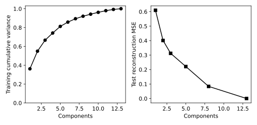

# 9.12 PCA 설명 분산과 재구성 오차

차원 축소의 정보 보존을 훈련 설명 분산과 미관측 재구성 오차로 구분한다.

## 실행

```bash
python sec_12_pca_reconstruction.py
```

Python 3.12.14에서 정상 종료 확인. 장 폴더를 작업 위치로 삼아 실행하며, 프로그램은 스크립트 위치에서 입력 경로를 찾는다.

## 입력 자료

- `data/wine.csv`: 178행, 14열. scikit-learn 내장 Wine 데이터(load_wine), UCI Wine에서 유래한 178개 관측. 생성 자료 아님. 13개 연속형 화학 분석 특성과 target(0,1,2). 7장은 target==0을 양성으로 재정의한다. 물리 단위는 원 출처 설명을 확인한다.
- 열: alcohol, malic_acid, ash, alcalinity_of_ash, magnesium, total_phenols, flavanoids, nonflavanoid_phenols, proanthocyanins, color_intensity, hue, od280_od315_of_diluted_wines, proline, target
- SHA-256: `47946bdb6b5017961c6e2b5daa8a74b0d98779c1c66f21645d1d737eded7e8cb`

## 소스와 해설

[프로그램 원본](sec_12_pca_reconstruction.py)

시작 1~5행은 pathlib·sys와 공통 모듈의 경로 및 CSV/출력 폴더를 정한다. 입력은 스크립트 위치 기준이므로 사용자의 현재 작업 폴더와 분리된다.

- 11행 `scale=StandardScaler`: 훈련 자료의 평균·표준편차만 저장하고 두 분할을 같은 좌표로 변환한다. 단위가 서로 다른 특성이 분산을 지배하는 영향을 줄인다.

- 12행 `full=PCA`: PCA는 중심화된 훈련 입력의 분산 방향을 찾는다. explained_variance_ratio_는 각 성분의 분산 비율이고 cumsum은 앞 성분부터 합한 누적 비율이다.

- 15행 `m=PCA(n_components`: 성분 수가 다른 모델을 각자 훈련 자료에 적합한다. transform은 입력을 저차원 좌표로 보내고 inverse_transform은 다시 표준화 입력 공간으로 되돌린다.

- 17행 `scaled_test_mse`: 테스트 관측의 모든 열·모든 행 제곱 차이를 평균한다. 관측 하나당 합이나 원 단위 RMSE와 다른 정의이므로 분모 범위를 명확히 한다.

- 26행 `variance_first2`: 첫 두 성분의 누적 분산이 높아도 작은 분산 방향에 있던 분류 정보가 사라질 수 있다. 차원 축소의 목적에 따라 예측 성능이나 해석 검증을 추가해야 한다.

## 실제 실행 결과

```json
{
  "train_n": 124,
  "test_n": 54,
  "variance_first2": 0.5496008722014621,
  "reconstruction": [
    {
      "components": 1,
      "scaled_test_mse": 0.6095364010651653
    },
    {
      "components": 2,
      "scaled_test_mse": 0.40088476657451155
    },
    {
      "components": 3,
      "scaled_test_mse": 0.3120173677869732
    },
    {
      "components": 5,
      "scaled_test_mse": 0.2209629414664772
    },
    {
      "components": 8,
      "scaled_test_mse": 0.08390779160474185
    },
    {
      "components": 13,
      "scaled_test_mse": 1.4499782735682569e-30
    }
  ]
}
```



왼쪽은 훈련 분산의 누적 비율이다. 오른쪽 오차는 표준화된 입력 공간이며 원 단위 오차가 아니다.

PCA는 정답을 보존하도록 최적화하지 않는다. 분산 보존이 분류 정확도나 군집 의미 보존을 보장하지 않는다.

## 확인 과제와 채점 기준

2차원 그림이 전체 정보를 얼마나 유지하는지 분산 비율로 설명하고 13차원 복원 오차가 수치적으로 0에 가까운지 확인한다.

입력·분할·출처 확인 2점, 재실행과 산출물 일치 3점, 수치·그림 해석 3점, 한계와 실패 사례 설명 2점. 제출물은 변경 코드, 결과 CSV/JSON, 비교 그림, 5문장 해석이다.
