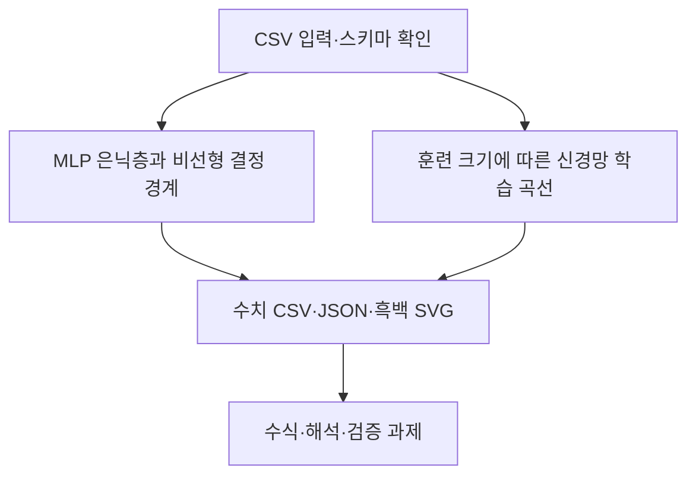

# 제10장 추가 실습

현재 Word 원고의 10.11절과 10.12절에 대응한다. 저장소의 기존 폴더 번호와 현재 Word 장 번호는 일부 다르므로 이 대응을 우선한다.

- [10.11 MLP 은닉층과 비선형 결정 경계](sec_11_mlp_boundary.md) — [코드](sec_11_mlp_boundary.py)
- [10.12 훈련 크기에 따른 신경망 학습 곡선](sec_12_mlp_learning_curve.md) — [코드](sec_12_mlp_learning_curve.py)

[통합 Jupyter 노트북](chapter_practice.ipynb) · [데이터 카드](data_card.json) · [편집 가능한 과정 원본](process.mmd)

[10.13 열별 데이터 사전과 검증 기준](dataset_guide.md) · [계산된 통계 JSON](data_profile.json)
