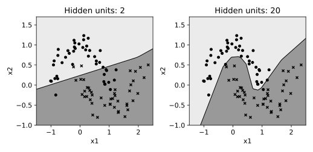

# 10.11 MLP 은닉층과 비선형 결정 경계

은닉 유닛 수가 비선형 결정 경계의 표현 능력에 미치는 영향을 시각화한다.

## 실행

```bash
python sec_11_mlp_boundary.py
```

Python 3.12.14에서 정상 종료 확인. 장 폴더를 작업 위치로 삼아 실행하며, 프로그램은 스크립트 위치에서 입력 경로를 찾는다.

## 입력 자료

- `data/moons.csv`: 300행, 3열. scikit-learn make_moons로 생성한 교육용 합성 데이터, random_state=42. x1/x2는 무차원 평면 좌표. 군집화에는 정답 target을 입력하지 않는다.
- 열: x1, x2, target
- SHA-256: `3cfcdf0ee96c8e65958d028fbbc388c1797e8359727b6b2703f172f56c07036d`

## 소스와 해설

[프로그램 원본](sec_11_mlp_boundary.py)

시작 1~5행은 pathlib·sys와 공통 모듈의 경로 및 CSV/출력 폴더를 정한다. 입력은 스크립트 위치 기준이므로 사용자의 현재 작업 폴더와 분리된다.

- 13행 `g0,g1=np.meshgrid`: 평면을 규칙 격자로 만들어 관측이 없는 위치에서도 모델의 확률을 그린다. 이 격자 점들은 학습 데이터나 새로운 정답 표본으로 쓰지 않는다.

- 17행 `hidden_layer_sizes`: (width,)의 쉼표는 원소 하나짜리 튜플을 뜻한다. 은닉층 하나에 width개 뉴런을 둔다는 의미이고 은닉층 width개를 뜻하지 않는다.

- 18행 `solver="lbfgs"`: 작은 자료에서 전배치 최적화를 수행하는 L-BFGS를 쓴다. max_iter는 최대 최적화 반복 수이며 실제 종료 반복은 n_iter_로 확인한다. SGD의 미니배치 epoch와 그대로 같은 수치가 아니다.

- 20행 `contourf`: 확률 0.5 경계를 기준으로 두 영역을 채운다. 확률이 0.51인 영역과 0.99인 영역이 같은 음영이므로 음영 농도를 확률 크기로 해석하지 않는다.

- 26행 `test_accuracy`: 표시한 정확도는 90개 테스트 관측의 결과다. 그림에서 보이는 평면 전체 영역의 정답률을 계산한 것이 아니다.

## 실제 실행 결과

```json
{
  "2": {
    "test_accuracy": 0.8555555555555555,
    "iterations": 42
  },
  "20": {
    "test_accuracy": 0.9666666666666667,
    "iterations": 147
  }
}
```



색조는 예측 확률 0.5를 기준으로 나눈 영역이다. 점은 테스트 관측이며 두 유닛·20유닛 모두 같은 훈련 분할을 쓴다.

구조 두 개를 본 뒤 선택한다면 테스트를 모델 선택에 사용한 셈이다. 이 비교는 교육용 탐색이며 확정 일반화 결론은 아니다.

## 확인 과제와 채점 기준

은닉 유닛 수 외에 alpha와 solver를 고정한 이유를 설명하고 분류 오류 점이 경계 어디에 모이는지 확인한다.

입력·분할·출처 확인 2점, 재실행과 산출물 일치 3점, 수치·그림 해석 3점, 한계와 실패 사례 설명 2점. 제출물은 변경 코드, 결과 CSV/JSON, 비교 그림, 5문장 해석이다.
