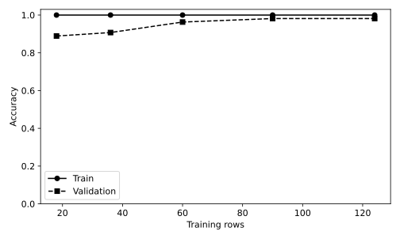

# 10.12 훈련 크기에 따른 신경망 학습 곡선

학습 자료의 양과 훈련·검증 격차를 연결하고 epoch 손실 곡선과 구분한다.

## 실행

```bash
python sec_12_mlp_learning_curve.py
```

Python 3.12.14에서 정상 종료 확인. 장 폴더를 작업 위치로 삼아 실행하며, 프로그램은 스크립트 위치에서 입력 경로를 찾는다.

## 입력 자료

- `data/wine.csv`: 178행, 14열. scikit-learn 내장 Wine 데이터(load_wine), UCI Wine에서 유래한 178개 관측. 생성 자료 아님. 13개 연속형 화학 분석 특성과 target(0,1,2). 7장은 target==0을 양성으로 재정의한다. 물리 단위는 원 출처 설명을 확인한다.
- 열: alcohol, malic_acid, ash, alcalinity_of_ash, magnesium, total_phenols, flavanoids, nonflavanoid_phenols, proanthocyanins, color_intensity, hue, od280_od315_of_diluted_wines, proline, target
- SHA-256: `47946bdb6b5017961c6e2b5daa8a74b0d98779c1c66f21645d1d737eded7e8cb`

## 소스와 해설

[프로그램 원본](sec_12_mlp_learning_curve.py)

시작 1~5행은 pathlib·sys와 공통 모듈의 경로 및 CSV/출력 폴더를 정한다. 입력은 스크립트 위치 기준이므로 사용자의 현재 작업 폴더와 분리된다.

- 12행 `pool,va=`: 최초에 검증 자료를 고정해 각 훈련 크기의 비교 조건을 맞춘다. pool은 일부 훈련 표본을 선택할 후보 집합이며 검증 표본을 포함하지 않는다.

- 15행 `by_class=`: 품종별 훈련 번호를 난수로 섞는다. 클래스별 목록을 번갈아 이어 작은 prefix에도 세 품종이 들어가도록 구성한다. 모든 prefix가 정확한 모집단 비율을 유지하는 것은 아니다.

- 17행 `ordered.extend`: None은 길이가 다른 목록을 맞추는 임시 자리표시자다. 실제 표본 번호에는 포함하지 않는다. 앞선 작은 훈련 집합은 이후 큰 훈련 집합 안에 포함된다.

- 19행 `for size in`: 각 size마다 새 전처리와 새 MLP를 학습한다. 큰 모델의 가중치를 이전 모델에서 이어받는 warm start 실험이 아니다.

- 25행 `validation_accuracy`: 같은 검증 관측에서 정확도를 재므로 데이터 양의 영향을 관찰하기 쉽다. 다만 검증을 반복 확인했기 때문에 추가 최종 테스트 없이 실서비스 성능을 확정하지 않는다.

## 실제 실행 결과

```json
{
  "validation_n": 54,
  "curve": [
    {
      "train_n": 18,
      "train_accuracy": 1.0,
      "validation_accuracy": 0.8888888888888888
    },
    {
      "train_n": 36,
      "train_accuracy": 1.0,
      "validation_accuracy": 0.9074074074074074
    },
    {
      "train_n": 60,
      "train_accuracy": 1.0,
      "validation_accuracy": 0.9629629629629629
    },
    {
      "train_n": 90,
      "train_accuracy": 1.0,
      "validation_accuracy": 0.9814814814814815
    },
    {
      "train_n": 124,
      "train_accuracy": 1.0,
      "validation_accuracy": 0.9814814814814815
    }
  ]
}
```



가로축은 훈련 표본 수다. 각 점마다 새로운 모델을 훈련하므로 동일 모델의 연속 epoch를 그린 것이 아니다.

검증 표본은 고정되어 있고 단일 시드 결과다. 더 많은 자료가 언제나 단조롭게 성능을 높인다고 주장하지 않는다.

## 확인 과제와 채점 기준

작은 표본에서도 모든 클래스가 포함되는지 확인하고, 학습 곡선에 여러 시드의 변동 폭을 추가할 방법을 제안한다.

입력·분할·출처 확인 2점, 재실행과 산출물 일치 3점, 수치·그림 해석 3점, 한계와 실패 사례 설명 2점. 제출물은 변경 코드, 결과 CSV/JSON, 비교 그림, 5문장 해석이다.
