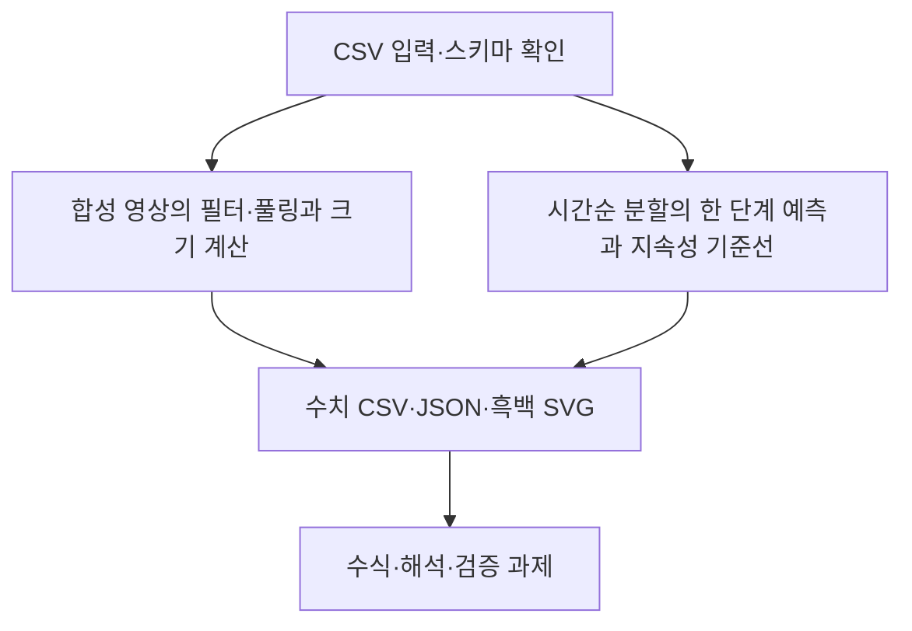

# 제11장 추가 실습

현재 Word 원고의 11.11절과 11.12절에 대응한다. 저장소의 기존 폴더 번호와 현재 Word 장 번호는 일부 다르므로 이 대응을 우선한다.

- [11.11 합성 영상의 필터·풀링과 크기 계산](sec_11_convolution.md) — [코드](sec_11_convolution.py)
- [11.12 시간순 분할의 한 단계 예측과 지속성 기준선](sec_12_timeseries_forecast.md) — [코드](sec_12_timeseries_forecast.py)

[통합 Jupyter 노트북](chapter_practice.ipynb) · [데이터 카드](data_card.json) · [편집 가능한 과정 원본](process.mmd)

