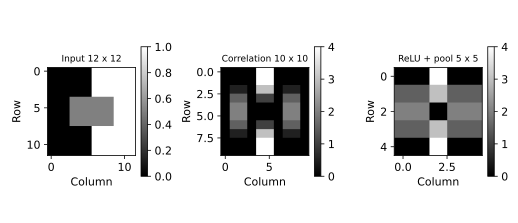

# 11.11 합성 영상의 필터·풀링과 크기 계산

고정 필터의 국소 연산과 활성화·풀링을 배열 수준에서 확인한다.

## 실행

```bash
python sec_11_convolution.py
```

Python 3.12.14에서 정상 종료 확인. 장 폴더를 작업 위치로 삼아 실행하며, 프로그램은 스크립트 위치에서 입력 경로를 찾는다.

## 입력 자료

- `data/image.csv`: 12행, 12열. 교육용 12×12 합성 회색조 영상. 실제 사진 아님. 한 셀은 픽셀, 0~1 밝기. 수직 경계와 사각형을 정의했다.
- 열: c0, c1, c2, c3, c4, c5, c6, c7, c8, c9, c10, c11
- SHA-256: `be57a9e1516719275f8191803cf2585b9e85f36c7ab4fa962a17ecfb45337c79`

## 소스와 해설

[프로그램 원본](sec_11_convolution.py)

시작 1~5행은 pathlib·sys와 공통 모듈의 경로 및 CSV/출력 폴더를 정한다. 입력은 스크립트 위치 기준이므로 사용자의 현재 작업 폴더와 분리된다.

- 9행 `sliding_window_view`: 12×12 입력에서 3×3 창을 한 칸씩 이동하면 (10,10,3,3) 형태의 창 뷰가 생긴다. 이 함수는 창을 읽는 배열 표현이며 학습된 특징 추출기 자체가 아니다.

- 10행 `np.einsum`: ijab는 출력 위치 i,j와 커널 위치 a,b다. 커널의 a,b를 곱해 합산하고 출력 위치 i,j만 남긴다. 커널을 뒤집지 않았으므로 CNN에서 흔히 쓰는 cross-correlation 연산이다.

- 11행 `activated=np.maximum`: 각 응답과 0 중 큰 값을 선택해 음수를 0으로 만든다. 이것이 Rectified Linear Unit(정류 선형 유닛, ReLU)이다. 양·음 경계 반응 중 음수 정보는 이 단계에서 사라진다.

- 12행 `reshape(5,2,5,2)`: 10×10 공간을 5개의 2행 블록과 5개의 2열 블록으로 나눈다. axis=(1,3)의 최댓값이 각 2×2 영역의 최대 풀링을 만든다. 배치나 채널 축이 없는 단순 2차원 예다.

- 24행 `assert feature.shape`: 출력의 위치별 값뿐 아니라 형상도 검증한다. 입력 크기·패딩·커널·스트라이드를 바꾸면 reshape의 5라는 숫자도 함께 다시 계산해야 한다.

## 실제 실행 결과

```json
{
  "input_shape": [
    12,
    12
  ],
  "feature_shape": [
    10,
    10
  ],
  "pooled_shape": [
    5,
    5
  ],
  "kernel": [
    [
      -1.0,
      0.0,
      1.0
    ],
    [
      -2.0,
      0.0,
      2.0
    ],
    [
      -1.0,
      0.0,
      1.0
    ]
  ],
  "stride": 1,
  "padding": 0
}
```



첫 그림은 원 영상, 두 번째는 부호가 있는 응답, 세 번째는 ReLU 뒤 최대 풀링이다. 각 패널의 색 범위가 달라 색 농도를 직접 비교하지 않는다.

학습된 CNN이나 영상 분류 성능 실험이 아니다. 커널을 뒤집지 않는 상관 연산이며 단일 채널·단일 필터만 다룬다.

## 확인 과제와 채점 기준

(12−3)/1+1=10과 풀링 10/2=5를 실제 shape와 대조하고 커널 부호를 바꾸었을 때 응답 방향을 설명한다.

입력·분할·출처 확인 2점, 재실행과 산출물 일치 3점, 수치·그림 해석 3점, 한계와 실패 사례 설명 2점. 제출물은 변경 코드, 결과 CSV/JSON, 비교 그림, 5문장 해석이다.
