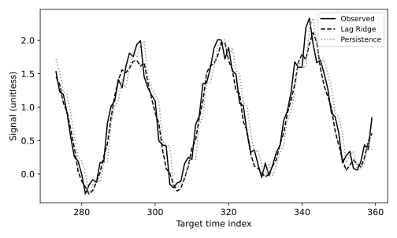

# 11.12 시간순 분할의 한 단계 예측과 지속성 기준선

과거 12개 값으로 다음 한 값을 예측하고 아무 학습도 하지 않는 지속성 예측과 비교한다.

## 실행

```bash
python sec_12_timeseries_forecast.py
```

Python 3.12.14에서 정상 종료 확인. 장 폴더를 작업 위치로 삼아 실행하며, 프로그램은 스크립트 위치에서 입력 경로를 찾는다.

## 입력 자료

- `data/series.csv`: 360행, 2열. 시드 42로 만든 주기 24, 선형 추세 0.003t, 잡음의 교육용 합성 시계열. t는 순서 번호이며 실제 시간 단위 아님. 미래 t의 값을 훈련 입력에 넣지 않는다.
- 열: t, signal
- SHA-256: `c32e8005864ea5af0e1b6d652719382f4323a4bcaaeefe5c1607b6d50ac2029e`

## 소스와 해설

[프로그램 원본](sec_12_timeseries_forecast.py)

시작 1~5행은 pathlib·sys와 공통 모듈의 경로 및 CSV/출력 폴더를 정한다. 입력은 스크립트 위치 기준이므로 사용자의 현재 작업 폴더와 분리된다.

- 11행 `sliding_window_view`: 길이 12의 과거 창을 만든 후 마지막 창을 제외한다. y=values[12:]와 길이를 맞추어 X의 각 마지막 관측 다음 값이 정답이 되게 한다.

- 13행 `cut=int`: 앞 75% 윈도를 훈련, 뒤 25%를 테스트로 사용한다. 무작위 셔플을 하지 않으므로 미래 목표가 과거 학습에 들어가지 않는다.

- 15행 `m.fit(X[:cut]`: 표준화 통계와 회귀 계수는 훈련 윈도에서만 학습한다. target_t는 정답이 놓인 시점이므로 시계열 선의 가로축도 같은 시간을 사용한다.

- 15행 `baseline=X[cut:,-1]`: 지속성 기준선은 가장 최근 관측이 다음에도 유지된다고 예측한다. 매우 단순하지만 강한 기준선일 수 있으므로 복잡한 모델의 개선을 판단할 기준이 된다.

- 26행 `assert target_t`: 마지막 훈련 목표가 첫 테스트 목표보다 과거인지 검사한다. 실제 운영에서는 관측 지연과 label availability를 추가로 확인해야 한다. 이 실험은 각 시점의 직전 실제 관측을 이용하는 한 단계 평가다.

## 실제 실행 결과

```json
{
  "train_windows": 261,
  "test_windows": 87,
  "metrics": {
    "ridge": {
      "RMSE": 0.17834284419927388,
      "MAE": 0.15006759504095918
    },
    "persistence": {
      "RMSE": 0.2624706632413813,
      "MAE": 0.20958071257908045
    }
  }
}
```



테스트 각 시점에서 직전 실제 관측이 사용 가능한 한 단계 rolling 예측이다. 고정 시점에서 미래 전체를 한 번에 내다본 다단계 예측이 아니다.

Ridge 기준선 예제이며 LSTM 성능이라고 부르지 않는다. 중첩 윈도는 경계의 과거 관측을 공유하지만 미래 목표를 훈련에 넣지는 않는다.

## 확인 과제와 채점 기준

각 X 행의 마지막 시간보다 y의 시간이 1 크다는 것을 확인하고, lag를 1·12·24로 바꾸어 비교한다.

입력·분할·출처 확인 2점, 재실행과 산출물 일치 3점, 수치·그림 해석 3점, 한계와 실패 사례 설명 2점. 제출물은 변경 코드, 결과 CSV/JSON, 비교 그림, 5문장 해석이다.
