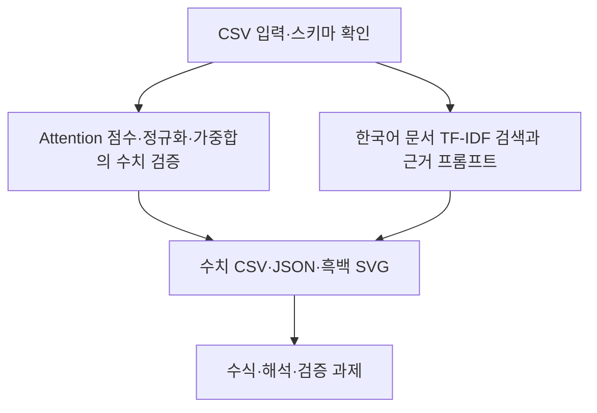

# 제12장 추가 실습

현재 Word 원고의 12.11절과 12.12절에 대응한다. 저장소의 기존 폴더 번호와 현재 Word 장 번호는 일부 다르므로 이 대응을 우선한다.

- [12.11 Attention 점수·정규화·가중합의 수치 검증](sec_11_attention.md) — [코드](sec_11_attention.py)
- [12.12 한국어 문서 TF-IDF 검색과 근거 프롬프트](sec_12_retrieval.md) — [코드](sec_12_retrieval.py)

[통합 Jupyter 노트북](chapter_practice.ipynb) · [데이터 카드](data_card.json) · [편집 가능한 과정 원본](process.mmd)

[12.13 열별 데이터 사전과 검증 기준](dataset_guide.md) · [계산된 통계 JSON](data_profile.json)
