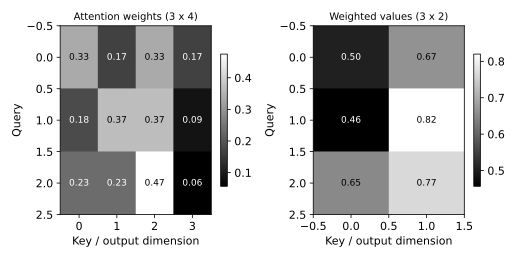

# 12.11 Attention 점수·정규화·가중합의 수치 검증

QKᵀ 점수·차원 스케일링·행별 Softmax·V 가중합을 작은 행렬로 직접 검증한다.

## 실행

```bash
python sec_11_attention.py
```

Python 3.12.14에서 정상 종료 확인. 장 폴더를 작업 위치로 삼아 실행하며, 프로그램은 스크립트 위치에서 입력 경로를 찾는다.

## 입력 자료

- `data/queries.csv`: 3행, 2열. 직접 정의한 교육용 Q 행렬. 학습된 언어 임베딩 아님. 질의 3개×차원 2.
- 열: d0, d1
- SHA-256: `d5f504cc84b5811c3012e5bc66d9ed0adbc3f1de8c421d14eedc2430330fde1c`

- `data/keys.csv`: 4행, 2열. 직접 정의한 교육용 K 행렬. 학습된 언어 임베딩 아님. 키 4개×차원 2. V는 코드에 고정된 4×2 행렬.
- 열: d0, d1
- SHA-256: `f0cc913cc88a2705694fb0557ddc724ca929d2d37862ff4fcedcd1601559f4d9`

## 소스와 해설

[프로그램 원본](sec_11_attention.py)

시작 1~5행은 pathlib·sys와 공통 모듈의 경로 및 CSV/출력 폴더를 정한다. 입력은 스크립트 위치 기준이므로 사용자의 현재 작업 폴더와 분리된다.

- 9행 `logits=Q@K.T`: Q는 3×2, Kᵀ는 2×4이므로 점수는 3×4다. @는 행렬곱이며 같은 위치끼리 곱하는 *와 다르다. 키 차원 2의 제곱근으로 점수 크기를 조절한다.

- 10행 `stable=logits`: 각 행의 최대값을 빼 Softmax 지수 계산의 수치적 안정성을 높인다. 같은 행에서 공통 상수를 빼면 정규화 비율은 수학적으로 바뀌지 않는다.

- 10행 `axis=1,keepdims=True`: axis=1은 키가 나열된 열 방향이다. keepdims=True는 합의 모양을 3×1로 남겨 3×4 가중치에 행별 나눗셈이 적용되도록 한다.

- 12행 `output=weights@V`: 3×4 가중치와 4×2 값 행렬을 곱해 3×2 출력을 만든다. 출력 열은 키의 개수가 아니라 V의 차원 수에 의해 결정된다.

- 28행 `assert np.allclose`: 각 행의 합이 1인지 허용 오차를 두고 검사한다. 부동소수점에서 정확한 ==1 대신 allclose를 사용해 수치 오차와 구조 오류를 구분한다.

## 실제 실행 결과

```json
{
  "Q_shape": [
    3,
    2
  ],
  "K_shape": [
    4,
    2
  ],
  "V_shape": [
    4,
    2
  ],
  "row_sums": [
    1.0,
    0.9999999999999999,
    1.0
  ],
  "output_shape": [
    3,
    2
  ]
}
```



왼쪽 한 행은 질의 하나의 키 4개에 대한 가중치다. 오른쪽은 키 번호가 아니라 V의 출력 차원 2개다.

임베딩을 훈련하지 않았으며 실제 문장의 의미나 설명 가능한 중요도라고 주장하지 않는다. 인과 마스크도 없는 예다.

## 확인 과제와 채점 기준

첫 행의 가중치 4개를 손으로 더하고 첫 출력 벡터를 V의 가중합으로 재계산한다.

입력·분할·출처 확인 2점, 재실행과 산출물 일치 3점, 수치·그림 해석 3점, 한계와 실패 사례 설명 2점. 제출물은 변경 코드, 결과 CSV/JSON, 비교 그림, 5문장 해석이다.
