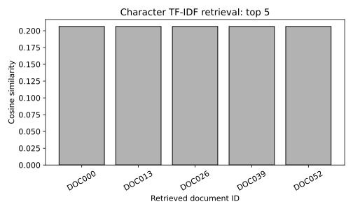

# 12.12 한국어 문서 TF-IDF 검색과 근거 프롬프트

질문과 문서의 검색 점수를 계산하고 근거 문서를 식별자로 연결한 프롬프트를 만든다.

## 실행

```bash
python sec_12_retrieval.py
```

Python 3.12.14에서 정상 종료 확인. 장 폴더를 작업 위치로 삼아 실행하며, 프로그램은 스크립트 위치에서 입력 경로를 찾는다.

## 입력 자료

- `data/documents.csv`: 60행, 3열. 기존 GitHub 12_Sequence_Transformer_GenerativeAI/course_documents.csv. id/title/content는 교육용 검색 문서. TF-IDF 문자 n-gram으로 점수 계산. 외부 LLM 호출 없음.
- 열: id, title, content
- SHA-256: `857a6db84ed8f1d6c32555471fd0b7fb12433a955d1175d9bca3c9e95d275f5e`

## 소스와 해설

[프로그램 원본](sec_12_retrieval.py)

시작 1~5행은 pathlib·sys와 공통 모듈의 경로 및 CSV/출력 폴더를 정한다. 입력은 스크립트 위치 기준이므로 사용자의 현재 작업 폴더와 분리된다.

- 9행 `analyzer="char"`: 한국어 공백·조사 변화에 단순 단어 분리보다 덜 민감하도록 2~4문자 조각을 특징으로 만든다. 형태소 분석이나 의미 임베딩을 수행한 것은 아니다.

- 10행 `fit_transform(f.content)`: 문서 집합에서 어휘와 IDF를 학습한다. 검색 질의는 transform만 호출해 이미 정한 어휘 공간으로 보낸다. 검색 시스템의 인덱싱과 모델 성능 평가용 데이터 분할은 목적이 다르다.

- 7행 `cosine_similarity`: 질의 벡터와 모든 문서 벡터 사이의 코사인 유사도를 계산한다. toarray로 전체 문서 행렬을 크게 펼치지 않고 희소 표현을 이용한다.

- 13행 `np.argsort(-scores`: 음수 점수로 정렬해 큰 점수부터 고른다. stable은 동점 문서의 원래 순서를 보존한다. 상위 5개 문서가 모두 관련 있다는 뜻은 아니므로 사람이 원문을 확인해야 한다.

- 16행 `context=`: 점수가 0보다 큰 결과만 근거 문맥에 넣고 문서 ID를 붙인다. 프롬프트는 출력 텍스트일 뿐 실제 언어 모델의 답변이 아니므로 LLM_called를 False로 기록한다.

## 실제 실행 결과

```json
{
  "documents": 60,
  "question": "데이터 전처리와 결측값 처리 방법은?",
  "top_ids": [
    "DOC000",
    "DOC013",
    "DOC026",
    "DOC039",
    "DOC052"
  ],
  "top_scores": [
    0.20643015755249697,
    0.20643015755249697,
    0.20643015755249697,
    0.20643015755249697,
    0.20643015755249697
  ],
  "LLM_called": false
}
```



막대는 코사인 유사도이며 답변의 사실성 확률이 아니다. 동점은 원래 문서 순서로 정렬하여 재현성을 유지한다.

생성 모델은 호출하지 않는다. 프롬프트 저장까지 검증했으며 RAG 답변 생성·환각 감소 성능을 측정한 것이 아니다.

## 확인 과제와 채점 기준

질문을 두 개 바꾸고 top-5 문서를 사람이 읽어 관련성 0/1/2점을 매겨 검색 실패 원인을 적는다.

입력·분할·출처 확인 2점, 재실행과 산출물 일치 3점, 수치·그림 해석 3점, 한계와 실패 사례 설명 2점. 제출물은 변경 코드, 결과 CSV/JSON, 비교 그림, 5문장 해석이다.
