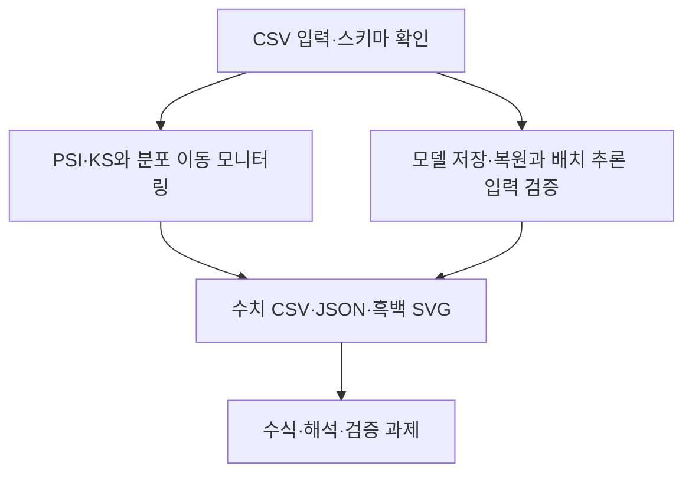

# 제13장 추가 실습

현재 Word 원고의 13.11절과 13.12절에 대응한다. 저장소의 기존 폴더 번호와 현재 Word 장 번호는 일부 다르므로 이 대응을 우선한다.

- [13.11 PSI·KS와 분포 이동 모니터링](sec_11_drift_monitor.md) — [코드](sec_11_drift_monitor.py)
- [13.12 모델 저장·복원과 배치 추론 입력 검증](sec_12_model_roundtrip.md) — [코드](sec_12_model_roundtrip.py)

[통합 Jupyter 노트북](chapter_practice.ipynb) · [데이터 카드](data_card.json) · [편집 가능한 과정 원본](process.mmd)

[13.13 열별 데이터 사전과 검증 기준](dataset_guide.md) · [계산된 통계 JSON](data_profile.json)
