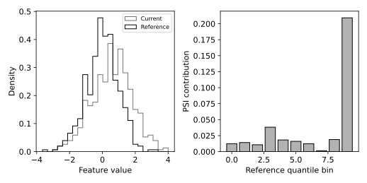

# 13.11 PSI·KS와 분포 이동 모니터링

분포 모양과 PSI 기여 구간, KS 통계량을 함께 확인한다.

## 실행

```bash
python sec_11_drift_monitor.py
```

Python 3.12.14에서 정상 종료 확인. 장 폴더를 작업 위치로 삼아 실행하며, 프로그램은 스크립트 위치에서 입력 경로를 찾는다.

## 입력 자료

- `data/drift.csv`: 500행, 2열. 시드 42의 교육용 합성 분포 이동. 실서비스 데이터 아님. 두 열은 각각 500개 기준·현재 관측. 짝지은 관측이 아니다. 평균과 척도를 다르게 설정했다.
- 열: reference, current
- SHA-256: `c556da87dc5079bc0a8079064b6f457fbd25ff494ce3386c80f2300067f99ca9`

## 소스와 해설

[프로그램 원본](sec_11_drift_monitor.py)

시작 1~5행은 pathlib·sys와 공통 모듈의 경로 및 CSV/출력 폴더를 정한다. 입력은 스크립트 위치 기준이므로 사용자의 현재 작업 폴더와 분리된다.

- 9행 `edges=np.quantile`: 기준 자료의 십분위수로 공통 구간을 정한다. 현재 자료로도 별도 구간을 계산하면 같은 열 번호가 다른 범위를 뜻해 두 비율을 직접 비교할 수 없다.

- 9행 `edges[0]=-np.inf`: 양끝을 무한대로 열어 기준 범위 밖 현재 관측도 첫·마지막 빈에 포함한다. 표본이 누락되면 비율 합과 PSI가 왜곡된다.

- 12행 `eps=1e-6`: 0 비율에서 로그가 정의되지 않는 문제를 피하기 위해 작은 의사 비율을 더하고 합이 1이 되도록 재정규화한다. 이 처리는 작은 빈에서 결과에 영향을 줄 수 있으므로 값과 규칙을 남긴다.

- 13행 `contribution=`: PSI는 Σ(q−p)ln(q/p)다. 현재 비율 q와 기준 비율 p가 같으면 각 기여가 0이다. 막대는 어느 기준 구간의 분포가 달라졌는지 보여 준다.

- 14행 `ks=ks_2samp`: KS는 두 경험 누적분포의 최대 거리와 p값을 계산한다. p값은 표본 수와 가정에 영향을 받으며 PSI와 같은 척도가 아니다. 여러 특성의 다중 검정은 별도 고려해야 한다.

## 실제 실행 결과

```json
{
  "PSI": 0.3512911234541295,
  "KS_statistic": 0.258,
  "KS_pvalue": 4.977431397171044e-15,
  "reference_n": 500,
  "current_n": 500
}
```



빈 경계는 기준 자료의 분위수에서만 정했다. 양끝은 무한대로 열어 현재 값이 기준 범위를 벗어나도 누락되지 않게 한다.

PSI의 고정 경보 기준은 업종·표본·특성마다 검증해야 한다. 입력 드리프트를 성능 하락이나 개념 드리프트와 동일시하지 않는다.

## 확인 과제와 채점 기준

현재 열에 기준 열을 복사한 비교 시나리오를 만들어 PSI가 0에 가까워지는지 확인한다.

입력·분할·출처 확인 2점, 재실행과 산출물 일치 3점, 수치·그림 해석 3점, 한계와 실패 사례 설명 2점. 제출물은 변경 코드, 결과 CSV/JSON, 비교 그림, 5문장 해석이다.
