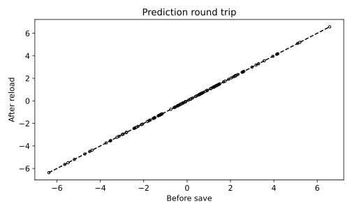

# 13.12 모델 저장·복원과 배치 추론 입력 검증

전처리와 회귀 모델을 함께 저장하고 복원 전후 예측과 입력 거부 동작을 확인한다.

## 실행

```bash
python sec_12_model_roundtrip.py
```

Python 3.12.14에서 정상 종료 확인. 장 폴더를 작업 위치로 삼아 실행하며, 프로그램은 스크립트 위치에서 입력 경로를 찾는다.

## 입력 자료

- `data/serving.csv`: 360행, 4열. 시드 42의 교육용 합성 회귀. 실제 운영 성능을 의미하지 않음. 3개 무차원 입력과 연속형 목표. 모델 저장·복원·입력 검증용.
- 열: x0, x1, x2, target
- SHA-256: `69d5c7f43cafdfc91fe607b9d402917892060415110b725f8c02eb0532145ada`

## 소스와 해설

[프로그램 원본](sec_12_model_roundtrip.py)

시작 1~5행은 pathlib·sys와 공통 모듈의 경로 및 CSV/출력 폴더를 정한다. 입력은 스크립트 위치 기준이므로 사용자의 현재 작업 폴더와 분리된다.

- 16행 `joblib.dump`: 입력 열 목록과 전처리를 포함한 회귀 Pipeline을 함께 저장한다. 모델만 저장하고 scaler를 잃어버리면 같은 원 입력이 다른 좌표로 들어가 예측이 달라질 수 있다.

- 19행 `missing=set`: 요구 입력 열의 집합에서 전달받은 열 집합을 빼 누락을 찾는다. 순서 비교와 집합 비교는 다른 검사다. 누락이 없으면 저장된 features 순서로 재정렬한다.

- 22행 `np.isfinite`: dtype=float 변환이 가능한 수치 입력인지 확인한 뒤 NaN과 무한대를 거부한다. 범위 밖이지만 유한한 값까지 정상 범위로 보장하는 검사는 아니다.

- 28행 `except ValueError`: 의도적으로 x1 열을 뺀 요청을 넣고 명확한 예외가 나는지 확인한다. 예외가 나지 않으면 AssertionError를 발생시켜 입력 검증 실패를 성공으로 기록하지 않는다.

- 39행 `assert np.allclose`: 동일 모델을 저장·복원한 전후 예측 벡터를 비교한다. 이 일치는 모델 성능과는 별개다. 실제 정답에 대한 RMSE는 별도의 test_RMSE로 남긴다.

## 실제 실행 결과

```json
{
  "test_n": 108,
  "max_abs_diff": 0.0,
  "test_RMSE": 0.19421003354419544,
  "missing_field_rejected": "Missing fields: ['x1']"
}
```



대각선에 점이 놓이면 저장·복원 전후 출력이 같다. 실제 정답과 예측이 같다는 그림은 아니다.

웹 서버를 배포한 예제가 아니다. 신뢰할 수 없는 joblib 파일은 열지 않으며 운영 버전·권한·동시 요청은 별도 구현이 필요하다.

## 확인 과제와 채점 기준

열 순서를 뒤집어도 features로 재정렬되는지 확인하고 NaN 입력의 거부를 추가 점검한다.

입력·분할·출처 확인 2점, 재실행과 산출물 일치 3점, 수치·그림 해석 3점, 한계와 실패 사례 설명 2점. 제출물은 변경 코드, 결과 CSV/JSON, 비교 그림, 5문장 해석이다.
